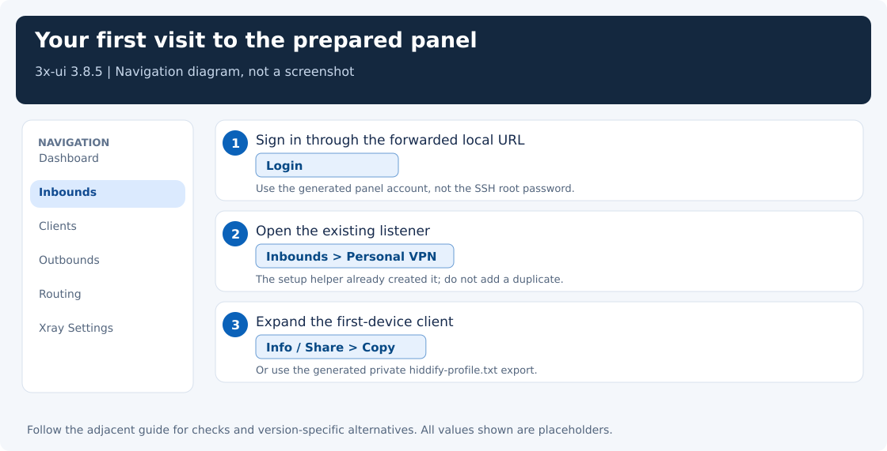

# VPN + Proxy in Russia

Set up a personal VLESS + REALITY server, connect your devices, and verify where their traffic exits. This setup can help with network filtering, but reachability depends on the provider, network, client engine, and server version.

## Start with the two details your provider sent you

Have a fresh VPS IPv4 address and its root password? Start with the [illustrated quick start](docs/quick-start.md). The helper prepares the server and the first profile, then shows exactly how to open 3x-ui and connect Hiddify. Windows has a PowerShell launcher; Linux/macOS has a Python launcher. Preview first, apply when ready.

Already have a working panel? Keep it. Follow the individual walkthroughs below; the fresh-server helper deliberately refuses to overwrite an existing installation.



The [quick start](docs/quick-start.md) walks through those clicks and the final exit-IP test. If you prefer configuring everything by hand, the server and inbound chapters show each field and button separately.

## Start here

| Your task | Guide |
|---|---|
| Choose a VPS and install 3x-ui | [Server setup](docs/server-setup.md) |
| Create an inbound and copy your connection link | [VLESS + REALITY settings](docs/server-inbound.md) |
| Make the server exit over IPv4 | [ForceIPv4 in the panel](docs/force-ipv4.md) |
| Connect a Windows PC or phone | [Client setup](docs/clients.md) |
| Understand Windows proxy ports and the Connect button | [Ports and connection modes](docs/ports-and-modes.md) |
| Fix a timeout, handshake error, or wrong exit address | [Troubleshooting](docs/troubleshooting.md) |
| Connect a Linux machine using Xray | [Linux Xray client](docs/linux-xray.md) |
| Automate profile setup and repeatable checks | [Helpful scripts](docs/automation.md) |
| Understand Xray as a programmer or network engineer | [Inside Xray](docs/xray-internals.md) |
| Let another device use your local proxy | [Share a proxy](docs/share-proxy.md) |

For a new installation, follow server setup, inbound settings, then client setup. For an existing server, start with client setup and keep the existing server parameters.

## What runs where?

```text
Your application → client app / local proxy → encrypted tunnel → VPS → website
```

3x-ui manages the server. Xray carries its traffic. A desktop or phone client imports the connection parameters and decides which local applications use the tunnel.

The server's public VPN port and the client's local proxy port are different settings. Connecting a client does not automatically guarantee that every application uses it.

Keep connection links and QR codes private: they contain client credentials. All examples in this repository use placeholders.
