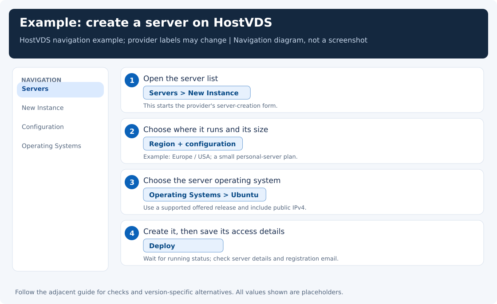

[← Setup overview](../README.md) · Step 1 of 4

# Get the computer that will run your VPN

You do not need to buy a physical machine or leave a laptop running at home. You rent a small virtual server in a data center. Providers call this a **VPS**, **VDS**, or **cloud server**. For this guide, it is a remote Linux computer that stays online and carries your VPN traffic.

Your own computer remains as it is. You can rent and administer an Ubuntu server from Windows, Linux, or macOS.

**Do this page only if you need a server.** Already have a running Ubuntu server and its login details? Skip this page and [open Step 2: install or open the dashboard](server-setup.md).

On this page, create **one** server using either the HostVDS example or another provider, then save its login details.

## Choose a provider and a location

The original setup in this project used [HostVDS](https://hostvds.com/) for a server abroad. It is an example, not a requirement. Any provider with suitable Linux servers, a public IP, enough transfer allowance, and working access from your network can fit this guide.

Choose the location where you want traffic to leave the VPN, such as a European or US location offered by your provider. A nearby location may reduce latency, but an actual connection test is more useful than geography alone. Check current payment methods, included traffic, and whether the provider accepts customers from your location before purchasing.

A second server in Russia is **not needed** for the ordinary setup. The [optional sharing chapter](share-proxy.md) describes cases where an intermediate proxy host is useful. Do not buy two servers just because a diagram in an advanced chapter shows two machines.

## Create one server: HostVDS example

If you want a concrete place to start, use [HostVDS](https://hostvds.com/). The provider's [own walkthrough](https://hostvds.com/knowledge/6) uses this creation flow:

1. Sign in, open **Servers**, and click **New Instance**.
2. Choose an available European or US region for the VPN exit. Check the current region list; you do not need one particular city.
3. Choose a small configuration—for a first personal setup, around **1 CPU / 1 GB RAM / 10 GB disk** is a starting point. Check the selected plan's current transfer allowance and public IPv4 option.
4. Select **Operating Systems → Ubuntu**. Use a supported release offered there; 24.04 is not mandatory.
5. Click **Deploy** and wait for the server to show as running in **Servers**.
6. Open its access details and check your registration email for the IP and root credentials.

Choose the plain Ubuntu operating-system image for the manual installation in this guide. HostVDS also offers application templates that may include 3x-ui already. If you deliberately use one, follow its supplied panel access instructions and skip reinstalling a panel that already exists.

If no root password arrives, HostVDS documents **Servers → Actions: Security → Change root password → Save new password** in its [access troubleshooting guide](https://hostvds.com/knowledge/7). Keep the resulting password private.

Using another provider? Open these alternative creation steps. Skip if you already created your server.

Use these instead of the HostVDS steps, then continue with “Save the details” below:

1. Register or sign in to the provider's website and add funds/payment details if required.
2. Open **Servers / Cloud / Instances** and choose **Create server**, **Create instance**, or **Order**.
3. Select the desired country or data center.
4. For the operating system, choose **Ubuntu Server**. A supported LTS release is a straightforward choice. Ubuntu 22.04 and 24.04 are examples; the guide does not require 24.04 specifically. Debian is another supported option for the optional setup helper, but this manual walkthrough uses Ubuntu commands.
5. Choose a small general-purpose plan. One CPU core, about 1 GiB RAM, and around 10 GiB disk are reasonable starting values for a personal setup. Actual capacity depends on load and the panel version.
6. Include a **public IPv4 address** and check the traffic allowance. You need an address your devices can reach from the internet, not only a private-network address.
7. If offered, select a root password or an SSH key that you know how to use. Save the login information privately.
8. Click **Create / Deploy / Order** and wait until the server shows **Running / Active**.

You do not need Windows Server, a desktop environment, a hosting control-panel bundle, a GPU, or a domain name for the basic VPN. The server's Ubuntu version and your laptop's operating system are separate choices.

If you already have a server with other software or files, do not reinstall its operating system to follow this guide. Check the existing installation and available ports, then add only what is needed.

## Save the details you will use next

Open the new server's **Details / Access / Credentials** page. The provider may also email them. You need:

| Detail | Example or meaning |
|---|---|
| Public IPv4 | The server's numeric address, such as `203.0.113.10` in documentation |
| Login user | Often `root`; some providers use an account such as `ubuntu` |
| Password or SSH key | The credential for that user |
| SSH port | Usually `22`, unless the provider says otherwise |
| Provider web console | Useful if a later network setting prevents a normal login |

`root` is the administrator account, not a password. A provider that creates an `ubuntu` user and an SSH key does not necessarily enable root-password login; follow the supplied access method instead of repeatedly guessing a root password.

## A firewall note before leaving the provider dashboard

A **firewall** decides which incoming connections the server accepts. Some providers put an extra one in their web dashboard, often called **Firewall**, **Security group**, or **Network rules**.

Keep the supplied SSH access allowed. Later, you will allow the actual VPN TCP port chosen during setup, usually 443 or 8443. If you use a public browser panel, its separate access rule and HTTPS setup matter too. The next chapter explains those ports when you reach them; there is no need to open every port in advance.

## Provider references

- [HostVDS website](https://hostvds.com/) and [knowledge base](https://hostvds.com/knowledge/1)
- [Ubuntu cloud-server tutorial](https://ubuntu.com/tutorials/launch-and-terminate-cloud-instances), for readers who want to understand the underlying cloud terminology

Provider forms and billing offers change. The actions above describe the task; consult the selected provider's current instructions for its exact form labels.

**Step 1 is complete when:** your server is running and you have its IP address and login method.

**[Next step: install and open the server dashboard →](server-setup.md)**
