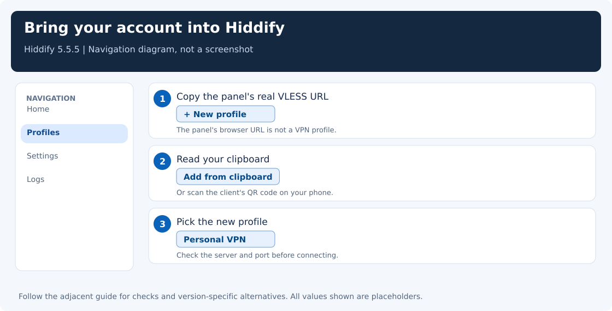
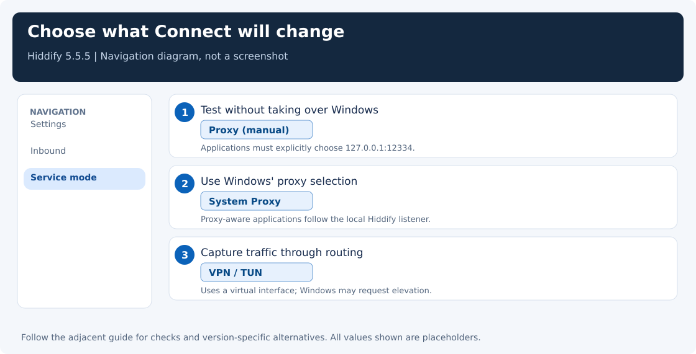
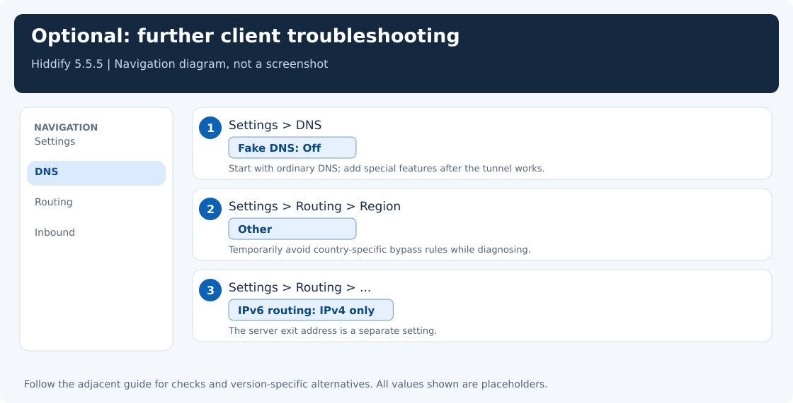
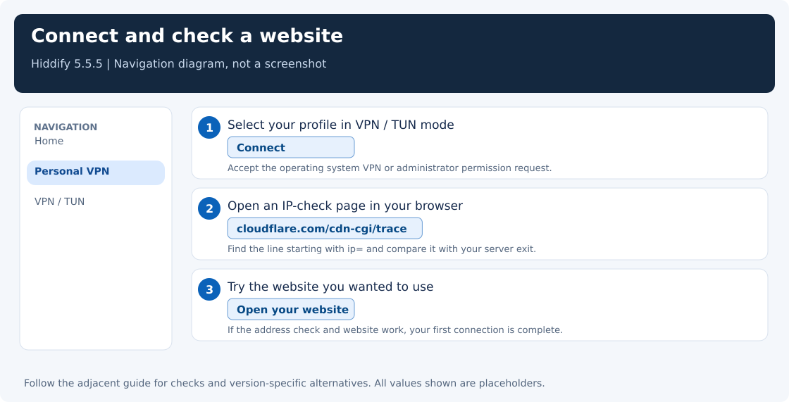

[← Guide index](../README.md) · Previous: [Create the server inbound](server-inbound.md) · Next: [Understand the ports and modes](ports-and-modes.md)

# Connect with Hiddify

You have a connection link from 3x-ui. The next job is to teach your computer where to send traffic. Hiddify does both parts: it opens the encrypted tunnel, then offers a local proxy or a virtual network interface for your applications.

This walkthrough uses **Hiddify 5.5.5 on Windows** and the equivalent import flow on phones. Labels can move between releases; check **About** before comparing your screen with a guide. A green connection indicator is a useful start, but the exit test at the end is what proves the route works.

## Give the link a home

Download Hiddify from the [official releases](https://github.com/hiddify/hiddify-app/releases/latest). On Windows x64, choose the setup or portable x64 package. For other operating systems, use the platform links on the [official installation page](https://hiddify.com/app/How-to-install-Hiddify-app/). Install the desktop app on Windows, not inside WSL.

1. Copy the real `vless://...` link from [your client account in 3x-ui](server-inbound.md#5-export-the-connection).
2. Open Hiddify and click **+** / **New profile**.
3. Select **Add from clipboard** / **Import from clipboard**. On a phone, scanning the client's QR code is another option.
4. Select the new profile, for example `Personal VPN`.

The profile name is cosmetic. Check that you selected the intended server, especially after importing several similar profiles. Do not substitute the panel URL for the VLESS link.

Treat the link like a password. It contains the account UUID and enough parameters to connect. A REALITY public key is public by design, but the complete URI still grants account access.



## Choose how much traffic Hiddify should handle

Open **Settings → Inbound → Service mode**. The three choices solve different problems:

| Mode | Choose it when | After Connect |
|---|---|---|
| **Proxy** (manual) | You want to test first or keep another client in charge of Windows | Hiddify listens locally; applications must explicitly use it |
| **System Proxy** | You want browsers and applications that follow Windows proxy settings to use Hiddify | Hiddify selects its local proxy in Windows |
| **VPN / TUN** | You need applications that ignore HTTP proxy settings to use the tunnel | Hiddify uses a virtual interface and routing; Windows may request elevation |

For the first test, choose **Proxy**. This keeps a running Invisible Man, another VPN, and Windows' current proxy selection untouched. Two clients may be open together, but they must not bind the same local port or keep replacing each other's system proxy.

On Android/iOS the normal VPN mode uses the operating system's VPN permission dialog. Allow the configuration when you intentionally connect; you do not enter a desktop localhost proxy into the phone's Wi-Fi settings for this mode.



## Start with a small, understandable configuration

The older guide suggested enabling Fake DNS whenever a website failed. That is too broad. First make the ordinary tunnel work; add special routing and DNS features later, one at a time.

For the Windows case investigated for this guide, a configuration without Fake DNS, regional bypass, or the experimental Clash API restored connectivity. This is a recovery baseline, not proof that any one of those features is broken on every machine.

Use the visible settings first:

| Open | Setting | Starting value |
|---|---|---|
| **Settings → Inbound → Local proxy** | Mixed/local proxy port | `12334`, enabled |
| **Settings → Inbound** | Share to LAN | Off for a personal device |
| **Settings → Inbound** | Local proxy authentication | Off when using System Proxy; Windows cannot supply those credentials automatically |
| **Settings → DNS** | Fake DNS | Off |
| **Settings → DNS** | Remote DNS | `tcp://8.8.8.8`, the tested baseline; it is sent through the selected proxy |
| **Settings → DNS** | Direct DNS | `udp://1.1.1.1`, the tested baseline; it uses the direct path |
| **Settings → Routing**, region chip at the top | Region | **Other** while diagnosing, to avoid adding country bypass rules |
| **Settings → Routing → ⋯** | IPv6 routing | **IPv4 only** for a simple initial client-side configuration |
| **Settings → Routing** | App-based routing | Off until the basic route is verified |
| **Settings → TLS tricks** | Fragmentation, padding, mixed-case SNI | Off until a particular network requires and validates them |
| **Settings → General** | Connection test URL | A reachable endpoint, for example `https://www.google.com/generate_204` |

A DNS provider may be blocked on your network; these addresses are examples that worked in the investigated setup. Direct DNS can reveal the names it resolves to the local resolver/network. Do not assume either a TCP resolver or an HTTP system proxy gives every application a DNS-leak-free route.

Other ports, WARP/extra-security chains, balancer settings, and TUN stack/MTU can stay at their defaults for this single-server setup. The Clash API is an application-control interface, not the browser proxy. Do not enter its port in Windows proxy settings.

After changing connection settings, disconnect and reconnect **Hiddify** so its running configuration is rebuilt. You do not need to close another client merely to test Hiddify on a different port.



## Press Connect, then prove the route

Click Hiddify's main **Connect** button. In manual Proxy mode, the local listener should now be available on `127.0.0.1:12334`.

Open PowerShell and run:

```powershell
curl.exe --noproxy localhost,127.0.0.1 --proxy http://127.0.0.1:12334 --connect-timeout 5 --max-time 15 https://www.cloudflare.com/cdn-cgi/trace
```

Use `curl.exe`, because older Windows PowerShell gives the shorter `curl` name a different meaning. The explicit proxy and external test URL also avoid accidentally testing an unrelated system proxy.

Look for `ip=` and `loc=`. The IP should be the VPS's outgoing address, with its expected location. A successful HTTP response through the proxy is stronger evidence than pinging the server. An IPv6 result can be the VPS's legitimate exit address; use the [ForceIPv4 guide](force-ipv4.md) if you want its IPv4 address.

Now open a browser. If the command works but the browser still uses your ordinary connection, check the service mode. In manual mode, that is expected. Select **Settings → Inbound → Service mode → System Proxy**, reconnect, and retry the browser when you want Hiddify to take over Windows' system proxy. See [what Windows changes](ports-and-modes.md#windows-selects-a-proxy-it-does-not-merge-them).

If the test fails, keep the profile and collect the error before changing server keys. Continue with [troubleshooting](troubleshooting.md).



## Advanced recovery when the normal settings are not enough

Hiddify 5.5.5 does not expose every core preference as a switch. In particular, its General page has a **Clash API port** field but no corresponding enable/disable toggle, and independent DNS cache is not a visible switch on its DNS page. Do not waste time looking for those controls.

For the tested recovery baseline, the saved preferences also used:

```text
flutter.enable-clash-api       false
flutter.independent-dns-cache  false
flutter.region                other
flutter.enable-fake-dns        false
flutter.service-mode          proxy
```

Use [the repair helper](automation.md#repair-hiddify-preferences-on-windows) to preview and, if needed, apply those settings. It requires Hiddify to be closed, backs up its preferences, never stops processes, and does not change Invisible Man or Windows' selected proxy. A backup is useful because disabling the API can affect API-based monitoring or integrations. Revert if you need those features, then test changes individually.

The effective file under `%APPDATA%\Hiddify\hiddify\data\current-config.json` is diagnostic output, not the persistent place to make this repair. Hiddify regenerates it.

## Leave Invisible Man installed, but use a maintained client for this setup

Invisible Man's upstream latest release checked on **2026-11-06** was **3.2.5**, dated **2025-02-02**, with Xray **25.1.30**. It is treated here as a legacy client without a current upstream release, not as the recommended client for a new server. That does not mean the executable can never work against any server.

With the same exported profile and provider, the investigation reproduced:

| Test | Result |
|---|---|
| Xray client **25.1.30** → Xray server **26.9.9** | `REALITY: processed invalid connection` |
| Xray client **26.10.31** → the same server | Authenticated HTTPS requests succeeded |
| Hiddify **5.5.5**, Windows native core, simple profile | Authenticated HTTPS requests succeeded |
| Hiddify **5.5.5**, repaired app settings above | App's real local proxy succeeded |

Reimporting a link does not update an old core's TLS handshake. Keep Hiddify and the server's core compatible; a new app version number alone is not sufficient evidence.

The checked 5.5.5 core reported `hiddify-sing-box 1.15.0-alpha.13`; its build also linked Xray 26.10.31. Those build facts do not mean it forwards traffic through Xray. Hiddify's build may include Xray libraries for parsing or conversion. In the checked 5.5.5 build, the Xray traffic backend was unimplemented and the global “use Xray” option was disabled in app code. We therefore repaired its native engine's configuration. Do not follow advice to flip a nonexistent engine selector or replace a DLL with `xray.exe`.

The [technical compatibility discussion](xray-internals.md#why-a-valid-profile-can-stop-working-after-an-update) explains why newer REALITY servers can reject older client handshakes. If you specifically need a GUI around standalone Xray, [v2rayN](https://github.com/2dust/v2rayN/releases/latest) is another option; verify its actual core version and test the tunnel.

## Keep a record that helps the next investigation

Write down panel version, server Xray version, client app version, client core version, and the last successful test date. A short note such as “Hiddify 5.5.5; manual proxy 12334; HTTPS through Kansas succeeded” is more useful than a screenshot of a green button alone. Do not include the account URI or passwords in that note.

## References

- [Invisible Man 3.2.5 release](https://github.com/InvisibleManVPN/InvisibleMan-XRayClient/releases/tag/v3.2.5)
- [Hiddify 5.5.5 settings screens](https://github.com/hiddify/hiddify-app/tree/v5.5.5/lib/features/settings/overview/sections)
- [Hiddify 5.5.5 configuration preferences](https://github.com/hiddify/hiddify-app/blob/v5.5.5/lib/features/settings/data/config_option_repository.dart)
- [Checked Hiddify core's Xray backend](https://github.com/hiddify/hiddify-sing-box/blob/1614c5edb52dd44a4cc079201ba1e790fdfad8a0/protocol/hiddify/xray/outbound.go)
- [Upstream REALITY compatibility report](https://github.com/SagerNet/sing-box/issues/4520)
