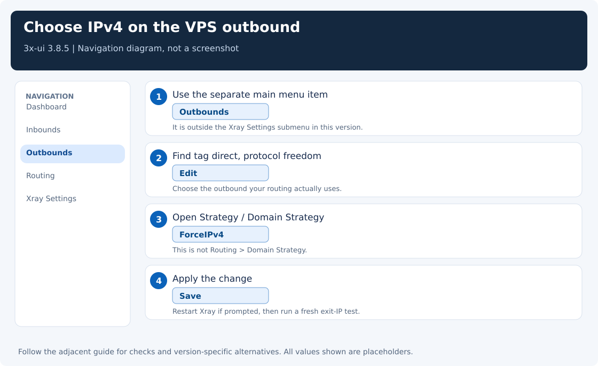

[← Guide index](../README.md) · [Server inbound](server-inbound.md) · [Troubleshooting](troubleshooting.md)

# Make the VPN server use an IPv4 exit

**Optional: use this page only if you want an IPv4 exit address.** A working connection with an IPv6 exit does not require this change. After changing the form, run the verification section; the JSON reference is optional.

The address a website sees after you connect is the server's **exit address**. It can be IPv4 (a dotted address such as `203.0.113.10`) or IPv6 (an address with colons, such as `2001:db8::10`).

If you want websites to see the server's IPv4 address, change the outgoing connection setting in **3x-ui**, the server's browser dashboard. This does not require changing your own computer's operating system or disabling IPv6 everywhere.

A client may connect to `YOUR_SERVER_IPV4:443` and still show the VPS's IPv6 address in an IP check. There are two separate connections:

```text
Client -- IPv4 tunnel --> VPS -- IPv4 or IPv6 --> Website
```

Hiddify's **IPv4 only** option does not select the address family of every server-side connection. Neither does `curl -4` by itself: when using an HTTP proxy, that flag can apply to the connection to the proxy, while the proxy resolves the website separately.

## Use the form: no JSON required

These instructions refer to **3x-ui 3.8.5**.

1. Open the main left sidebar. On a narrow screen, click the menu button; scroll the sidebar if necessary.
2. Click the separate **Outbounds** item. It is outside the **Xray Settings** submenu in this release.
3. Find the row tagged **`direct`**, with protocol **`freedom`**. If you have custom routing, check which outbound actually carries your client traffic first.
4. Click **Edit** or the pencil action on that row.
5. In the basic form, find **Strategy** / **Domain Strategy** and select **`ForceIPv4`**.
6. Save the outbound and apply/save the Xray configuration. Restart Xray if the panel requests it; existing tunnels may reconnect.
7. Run the exit test below.

Do not change **Routing → Domain Strategy** to `ForceIPv4`: that field serves a different purpose and uses values such as `AsIs` and `IPIfNonMatch`. Some other versions put an outbound's family strategy under **Sockopt / Socket Options**.

If you cannot find Outbounds, check the panel version on its dashboard. In 3.8.5 an alternative is **Xray Settings → Advanced → Outbounds**, above the JSON editor, but that alternative does involve editing JSON. Do not assume a tutorial's tabs match every release.



## What the choices mean

| Choice | Behavior for a destination hostname |
|---|---|
| `AsIs` | Normal resolution and address selection; IPv6 may be used |
| `UseIPv4` | Try IPv4 resolution, but an unsuccessful resolution may fall back to normal behavior |
| `ForceIPv4` | Require IPv4 resolution; do not fall back to IPv6 when no IPv4 result exists |

`ForceIPv4` is a hostname-resolution policy, not a host-wide IPv6 firewall. Explicit IPv6 destination addresses are a separate case. If you must reject those too, add a high-priority routing rule for destination IP **`::/0`** to the existing **blocked / blackhole** outbound, while preserving the panel's API and other required rules. A literal IPv6-only request will then fail. This is optional; do not add a broad block just to change the IP shown by one hostname-based exit check.

Do not disable the VPS's IPv6 networking or loopback merely to select an IPv4 VPN exit.

## Verify through the VPN

For Hiddify's default local proxy on Windows, run in PowerShell:

```powershell
curl.exe --noproxy localhost,127.0.0.1 --proxy http://127.0.0.1:12334 https://www.cloudflare.com/cdn-cgi/trace
```

For Hiddify on Linux/macOS, run:

```bash
curl --noproxy '' --proxy http://127.0.0.1:12334 https://www.cloudflare.com/cdn-cgi/trace
```

The optional standalone Linux Xray guide uses **10801** instead; substitute that port only if you followed that guide. Use the port your running client actually listens on. In the response, find `ip=`:

- An IPv4 address has dotted decimal notation, for example `203.0.113.10`.
- An IPv6 address contains colons, for example `2001:db8::10`.
- The address should belong to the VPS or its configured egress. Compare it with a direct check from that VPS.

Refresh Hiddify's IP/connection information or reconnect after changing the server; a cached display is not a fresh exit test. If a fresh request still exits over IPv6, inspect the effective configuration and routing: you may have edited an outbound that the traffic never uses.

## JSON reference for administrators

The UI is preferred for a panel-managed server. An effective configuration using the modern socket setting includes:

```json
{
  "tag": "direct",
  "protocol": "freedom",
  "settings": {},
  "streamSettings": {
    "sockopt": {
      "domainStrategy": "ForceIPv4"
    }
  }
}
```

This is a structural example, not a replacement for the existing outbound. Keep existing `settings`, `finalRules`, tags, and socket options. Panel versions may store the freedom strategy in `settings.domainStrategy` and let the core migrate it to sockopt. Avoid editing `/usr/local/x-ui/bin/config.json` as a permanent fix: 3x-ui regenerates that file.

To undo the change, return the same outbound's strategy to its previous value (often `AsIs`), save, and reconnect.

## References

- [3x-ui 3.8.5 sidebar](https://github.com/MHSanaei/3x-ui/blob/v3.8.5/frontend/src/layouts/AppSidebar.tsx)
- [3x-ui 3.8.5 freedom strategy field](https://github.com/MHSanaei/3x-ui/blob/v3.8.5/frontend/src/pages/xray/outbounds/protocols/freedom.tsx)
- [Xray socket resolution strategies](https://xtls.github.io/en/config/transports/sockopt.html#sockoptobject)
