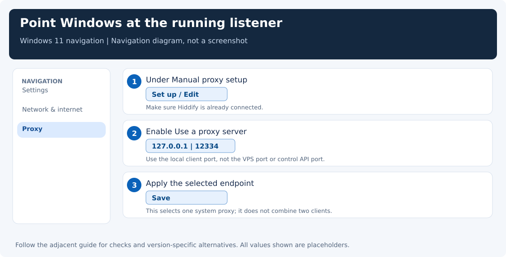

[← Guide index](../README.md) · [Hiddify setup](clients.md) · [Xray internals](xray-internals.md)

# One Connect button, several different network paths

You press Connect. The app turns green. Your browser may immediately use the VPS—or nothing in the browser may change at all. Both outcomes can be correct: the button starts the client, but the selected mode decides how your applications reach it.

A **port** is a numbered endpoint that lets several network programs share one machine's address. A **proxy** is a program that forwards a request for another application. Hiddify is the VPN app in this guide; it opens a proxy on your own computer, then carries selected requests to the remote server.

Follow one browser request from your desk to a website, and those numbers become much less mysterious.

## The ports you will see

| Place | Example endpoint | What it does |
|---|---|---|
| Your Windows PC | `127.0.0.1:12334` | Hiddify's local mixed HTTP/SOCKS proxy |
| The same PC | `127.0.0.1:10801` | An existing Invisible Man or standalone Xray proxy; its actual setting may differ |
| Your VPS | `YOUR_SERVER_IP:443` | The public VLESS + REALITY inbound; 8443 is another possible configured port |
| Your VPS | `YOUR_SERVER_IP:27297` | Example administration-panel port, not the VPN listener |
| Your PC | `127.0.0.1:16756` | Example Clash control API port, not a browser proxy |
| A website | `website.example:443` | HTTPS at the final destination |

These are examples, not globally reserved values for those apps. A program chooses its listener address and port. You can change a local proxy port if it is occupied, then update the applications that use it.

Port 443 has a familiar HTTPS convention; that does not mean your local proxy must use it. On the VPS, REALITY occupies its public listener. On your PC, 12334 can remain a perfectly ordinary local proxy port.

`127.0.0.1` means **this machine**. It is your PC when entered in Windows, and the VPS when entered over SSH. Changing it to `0.0.0.0` changes who can reach the listener; it does not make the proxy more effective.

## Manual Proxy mode: start a listener, then choose an application

In Hiddify, select **Settings → Inbound → Service mode → Proxy**, then Connect.

The app reads the selected profile, builds its routing/DNS configuration, starts the local core, and opens the enabled local proxy port. It may run background reachability checks. A connection to the VPS can be created on demand for each request; the status is not a promise that one permanent TCP tunnel already carries every program.

Nothing requires Windows to adopt this proxy in manual mode. Test it explicitly:

```powershell
curl.exe --noproxy localhost,127.0.0.1 --proxy http://127.0.0.1:12334 https://www.cloudflare.com/cdn-cgi/trace
```

The route is:

```text
curl.exe → Hiddify on this PC:12334 → encrypted tunnel → VPS:443 → Cloudflare:443
```

The local `http://` proxy URL describes how curl talks to Hiddify. For an HTTPS website, curl normally requests a CONNECT tunnel and then establishes the website's TLS connection through it. The local URL does not downgrade that website to HTTP.

## Windows selects a proxy; it does not merge them

When you select **System Proxy** and Connect, Hiddify also updates the Windows user's system proxy configuration. Applications that follow that configuration send requests to Hiddify's listener.

For Windows 11, you can see or set the same destination yourself:

1. Open **Settings → Network & internet → Proxy**.
2. Under **Manual proxy setup**, click **Set up** or **Edit**.
3. Turn **Use a proxy server** on.
4. Set **Proxy IP address** to `127.0.0.1` and **Port** to `12334`.
5. Click **Save**. The Hiddify listener must already be running.

The UI wording differs slightly on Windows 10. Microsoft documents the [Windows proxy settings](https://support.microsoft.com/en-us/windows/experience/connectivity-networking/use-a-proxy-server-in-windows).

Suppose Invisible Man listens on 10801 and Hiddify on 12334. They can both stay open. Windows' normal manual-proxy selection points at one endpoint, though individual applications may override it. Selecting 12334 does not send browser traffic through both clients in sequence. If both apps automatically manage system proxy settings, whichever changes the selection later can take over.

Keep their ports separate. A second program cannot bind the same address, port, and transport already owned by the first. To test Hiddify without disturbing another app, keep Hiddify in manual mode and use the explicit curl command above.

A system proxy also has limits. Some programs ignore it, some use their own proxy settings, and services using WinHTTP can have a separate configuration. UDP applications do not become HTTP-proxied just because the setting is enabled. Do not describe this mode as “every packet is now inside the VPN.”



## VPN / TUN mode: move the traffic selection into routing

In **Settings → Inbound → Service mode**, select **VPN / TUN** if you need applications that ignore the HTTP proxy to use the client. Windows may ask for administrator permission. On phones, the OS presents a VPN permission dialog.

Conceptually, the app starts the core, creates or attaches a virtual network interface, configures routes/DNS according to its mode and rules, and sends captured traffic through the selected outbound. The connection to the VPS itself needs a path outside that capture; otherwise the tunnel would try to carry itself.

TUN is broader than System Proxy, but it still follows configured routes, per-app choices, and bypass rules. Do not assume “kill switch,” “all DNS protected,” or “every address family captured” without checking those policies.

Avoid enabling two route-managing TUN clients at once unless you deliberately understand their interaction. You can still keep another application's window open without having it manage routes.

## What Disconnect changes

Hiddify stops or tears down the connection it owns. Depending on mode, that includes closing listeners, reverting the system proxy it manages, or removing its virtual interface/routes. Cleanup can be affected by crashes, forced termination, and another application changing the same setting.

If the internet stops working after closing a client, inspect Windows' proxy setting. A proxy aimed at a listener that no longer exists is a common cause. Select the running client you intend to use, or turn **Use a proxy server** off when you want a direct connection. Do not blindly erase corporate proxy/PAC settings.

## Check the actual state in PowerShell

Read the selected system proxy:

```powershell
Get-ItemProperty 'HKCU:\Software\Microsoft\Windows\CurrentVersion\Internet Settings' |
    Select-Object ProxyEnable, ProxyServer
```

`ProxyEnable = 1` plus `127.0.0.1:10801` means Windows still selects that endpoint; a green Hiddify icon does not change this fact in manual mode.

Read local listeners:

```powershell
Get-NetTCPConnection -State Listen |
    Where-Object { $_.LocalPort -in 10801,12334 } |
    Select-Object LocalAddress,LocalPort,OwningProcess
```

To identify one process, use `Get-Process -Id THE_PID_FROM_THE_TABLE`. These are read-only checks: they do not stop anything.

Read WinHTTP's separate proxy configuration, if a service is the program that fails:

```powershell
netsh winhttp show proxy
```

Do not import or reset WinHTTP settings just to repair a browser. Diagnose the application that actually fails.

## A note for WSL2 users

WSL2 is another network environment, not simply a second Windows shell. A successful WSL Xray test is excellent evidence that the provider can carry that protocol, but it does not prove the Windows application's parser, core, proxy selection, or firewall behavior is correct.

With mirrored networking, Windows and WSL can generally use localhost to reach one another's services. Under default NAT, a Linux process reaching a Windows service may need the Windows host address, and a loopback-only listener may not accept that path. Do not solve it by exposing an unauthenticated proxy to the whole LAN. See [Microsoft's WSL networking guide](https://learn.microsoft.com/en-us/windows/wsl/networking) before changing bind addresses.

For an unambiguous Windows test, run `curl.exe` from PowerShell against the Windows listener. For an unambiguous Linux test, run Linux curl against a Linux listener. Match the test to the thing you are trying to prove.
