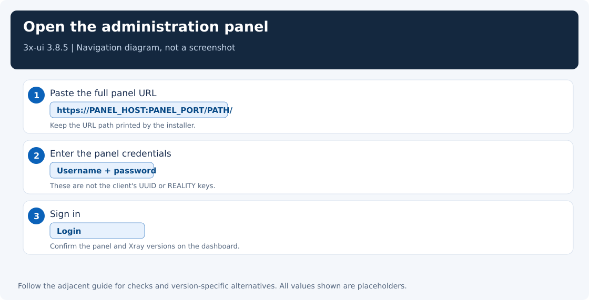
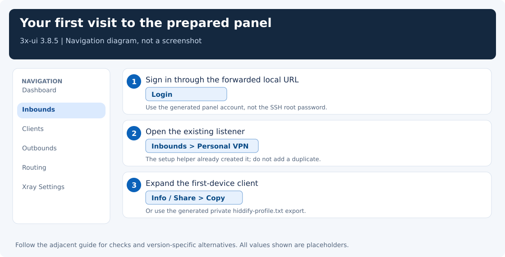
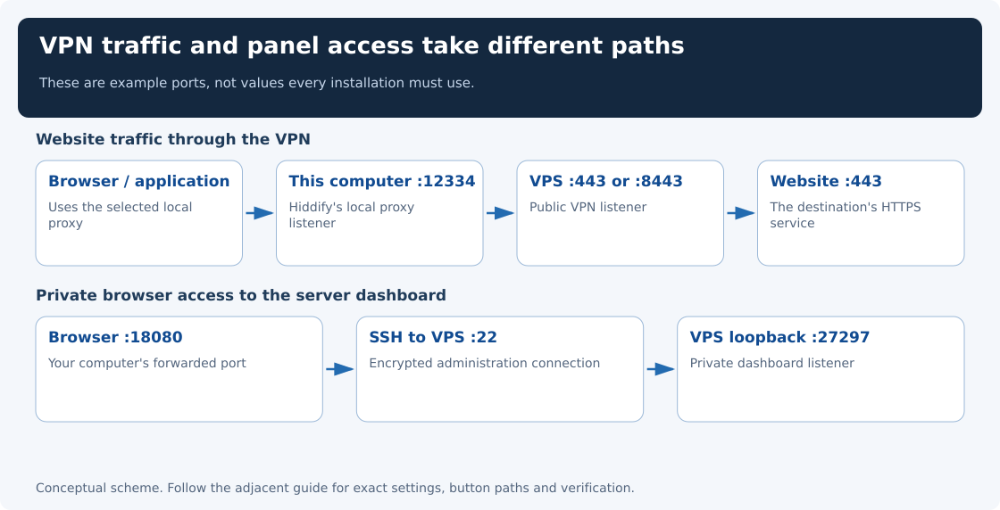
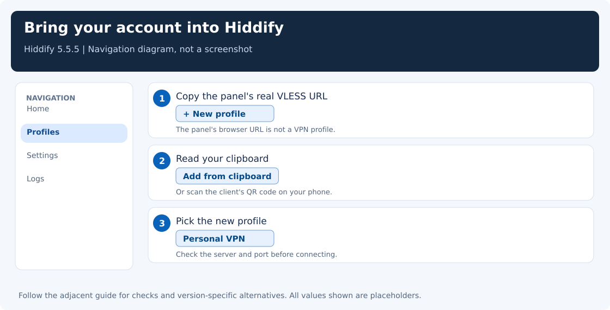

[← Guide index](../README.md) · [Manual server walkthrough](server-setup.md) · [What the helpers do](automation.md)

# Optional: let a helper prepare a new server

This is an optional alternative to the [manual setup walkthrough](server-setup.md). You can complete the whole main guide without running these helpers.

A **VPS** is a rented remote server; **root** is its administrator account. **SSH** is the secure terminal connection used to log in. The helper uses **OpenSSH**, the program providing that connection on your computer. If you do not have one yet, follow [choosing and creating a server](choose-server.md) first. Once the provider has supplied its IP and root login, a helper can automate the installation and account creation.

The helper prepares a new Ubuntu or Debian server that uses systemd, the normal service manager on those distributions. It does not require Ubuntu 24.04 specifically. You can launch it from Windows, Linux, or macOS.

It installs **3x-ui**, the server's browser dashboard, and generates a connection profile—a private link that tells a client app how to connect. The connection uses the VLESS + REALITY + Vision settings explained in the manual guide, with an IPv4 exit address—the address websites see. The desktop/phone app used below is **Hiddify**. It does not need a domain name or access to your provider account.

An existing 3x-ui installation is a different situation. The helper recognizes it and stops before resetting it. If you already have a panel, use [the existing-server walkthrough](server-inbound.md) and [Hiddify setup](clients.md); do not erase a working VPS to make an installer happy.

## Before the first command

Download this repository using Git or GitHub's **Code → Download ZIP**, extract it, and open a terminal in the folder containing `README.md` and `scripts/`.

On Windows, use **PowerShell** in that folder. Check that the built-in OpenSSH client is available:

```powershell
ssh -V
```

If Windows says the command is missing, install **OpenSSH Client** through Windows' Optional features, then reopen the terminal. The Windows launcher does not require local Python.

On Linux/macOS, have OpenSSH and Python 3.8+ available. The automatic server setup expects root SSH access on port 22; a custom SSH port is supported by a flag. The server needs internet/package access. Provider security-group changes may still require its website because a root password does not grant that separate account access.

## See the plan, then let SSH ask for the password

**Choose your computer’s operating system below.** Run the Windows commands or the Linux/macOS commands, not both.

On Windows, preview the plan:

```powershell
.\scripts\Setup-Vpn.ps1
```

Enter the VPS IPv4 address when asked. This first command does not connect or change anything.

Then run the real setup:

```powershell
.\scripts\Setup-Vpn.ps1 -Apply
```

If PowerShell blocks a script you have inspected and trust, you can allow just this process without changing the machine-wide execution policy:

```powershell
powershell.exe -NoProfile -ExecutionPolicy Bypass -File .\scripts\Setup-Vpn.ps1 -Apply
```

Respect managed-device policy; the manual walkthrough remains available if script execution is prohibited.

On Linux/macOS, the equivalent commands are:

```bash
python3 scripts/bootstrap_server.py --plan
python3 scripts/bootstrap_server.py --apply
```

The first SSH connection may ask you to confirm the server's host-key fingerprint. Compare it with the provider's console when available. After that, **SSH itself** asks for the root password. The password is hidden while you type; it never becomes a script argument, a configuration file, or a Git commit. SSH keys work too if you have already configured them.

Keep the terminal open. A fresh installation can take several minutes. The helper prints stages such as package preparation, panel installation, and client creation; it keeps installer output with generated credentials in a private log on the VPS.

## What the helper prepares for you

The default setup uses the version this guide describes, **3x-ui 3.8.5**, rather than silently following whatever a future latest release changes. It installs the official release through the official installer, then configures the new installation through its supported CLI and API.

You get:

- One VLESS + RAW/TCP + REALITY inbound and one `xtls-rprx-vision` account.
- Public VPN TCP port **443**, or **8443** if 443 is already occupied. It does not stop the existing listener.
- Generated UUID, REALITY keys, short ID, panel credentials, and panel URL path.
- A client fingerprint chosen from the VPS country: **Safari for the US**, **Chrome elsewhere**, with an explicit override available. This is a starting policy based on the [controlled Kansas comparison](troubleshooting.md#us-reality-server-chrome-times-out-but-safari-works), not a guarantee for every network.
- **ForceIPv4** on the server’s outgoing path, so hostname-based website requests use IPv4.
- A panel bound to **127.0.0.1:27297** on the VPS, accessed through SSH rather than exposed as public HTTP.
- The selected VPN port allowed in an existing UFW firewall, if active. UFW is Ubuntu’s firewall-management tool; the helper does not install or enable it. Existing SSH rules and custom/provider firewalls are not reset.
- A private `server.json` and `hiddify-profile.txt` saved under the repository's ignored `.secrets/` folder.

The helper checks that the server listener starts and probes its public TCP port from your computer. A reachable socket is still not an authenticated VPN test; importing the profile and running the final request below completes that check.

For a custom SSH or VPN port, use `-SshPort` / `-VpnPort` on Windows, or `--ssh-port` / `--vpn-port` with Python. Use `-PanelPort` / `--panel-port` if the administration port is occupied. Read the [automation details](automation.md#start-with-only-a-vps-ip-and-root-password) before changing defaults.

During **Apply**, the helper looks up the VPS's public IP country using [Country](https://country.is/); it sends the public IP, never your credentials. **Plan mode makes no lookup or SSH connection.** To skip that lookup or correct its result, add `-ServerCountry US` on Windows or `--server-country US` with Python; use another two-letter code for another country. To choose a tested preset yourself, add `-Fingerprint safari` / `--fingerprint safari` (or `chrome`, `firefox`, etc.). An explicit fingerprint overrides the country policy. If automatic lookup fails, the helper stops before installation and tells you which option to supply.

## Open 3x-ui without opening another public port

At the end, the helper prints a command similar to:

```bash
ssh -N -o ExitOnForwardFailure=yes -p 22 -L 127.0.0.1:18080:127.0.0.1:27297 root@YOUR_SERVER_IP
```

Open a **second terminal**, run the exact command printed for your server, and leave it running. SSH can ask for the password again. An apparently idle terminal is normal: it is forwarding the browser connection.

Now open the exact printed URL in your Windows/macOS/Linux browser:

```text
http://127.0.0.1:18080/YOUR_GENERATED_PATH/
```

This `127.0.0.1` is **your computer**. SSH forwards it to the panel's loopback listener on the VPS. The remote hop is protected by SSH; it does not require a public panel certificate or provider firewall rule for 27297. Do not replace that URL with `http://SERVER_IP:27297`—the helper deliberately made the panel private.



Open the generated `server.json` locally and find `panel_username` and `panel_password`. Enter those in the panel's **Username** and **Password** boxes and click **Login**. The root password is for SSH, not for this new panel account.

In the sidebar, click **Inbounds**. You should see **Personal VPN**, enabled, with the VPN port recorded in `server.json`. The account already exists: you do not need to click Add Inbound again.



**Optional check:** to inspect the IPv4 exit setting, use **Outbounds → direct → Edit → Strategy**. The setting was already applied by the helper; the [ForceIPv4 guide](force-ipv4.md) explains how to check it manually. Depending on the panel/core migration, its effective value can be stored under socket options even when a form displays the legacy field.

When you close the SSH-forwarding terminal, browser access stops. The VPN service remains running on the VPS. Reopen the same forwarding command whenever you need to administer the panel. If local port 18080 is occupied, use another unused local port in the `-L` command and in the browser URL.



## Bring the profile into Hiddify

The server and account are ready. Open the generated `hiddify-profile.txt` in a text editor and copy the whole `vless://...` line. This is your private connection profile.

**[Now follow Step 4: install Hiddify, import this link, and connect →](clients.md)**

**In Hiddify, set Settings → DNS → Outbound domain strategy → IPv4 only before reconnecting.** This is the author’s reported Android fix. The helper’s server-side ForceIPv4 setting does not set this option in your phone’s app.

The linked page gives the exact buttons, browser check, and optional additional recovery steps. You do not need to create another account in 3x-ui or run a preference-repair script first.



Copy the generated credentials/profile to your private password manager before deleting the working folder. `.secrets/` is deliberately not committed to Git. Do not paste those files into a public issue or screenshot.

## When the helper stops

A stopped helper tells you which stage needs attention. It does not roll back package installation, reset a database, or automatically wipe a partially installed server to try again.

| Message or symptom | What to do next |
|---|---|
| Existing 3x-ui detected | Open the existing panel or run `x-ui` over SSH to retrieve its settings; use the manual guide |
| Cannot authenticate over SSH | Recheck IP, root login permission, actual SSH port, and provider credentials; use a real interactive terminal |
| Port 443 is occupied | The helper chooses 8443 when available; allow the actual chosen port in the provider firewall |
| Public VPN TCP port is not reachable | In the provider website, find Firewall / Security group / Network rules and allow inbound **TCP** on the recorded VPN port; inspect custom host rules too |
| Installer or API stage failed | Read the private `/root/vpn-guide-bootstrap-*.log` over SSH; do not share it unredacted |
| Setup completed but local result files were not saved | Recover `/root/vpn-guide-bootstrap-result.json` privately over SSH |
| Browser cannot open the panel | Keep the SSH forward running; use its local port and the generated URL path |
| Hiddify errors after import | Follow the [handshake and generated-config checks](troubleshooting.md), including the documented recovery helper |

**Optional, after the connection works:** read [server administration improvements](server-setup.md#5-optional-improve-server-administration-later) if you want a separate administrator account and tighter SSH access. The helper leaves these choices to you.

<details>
<summary>For reviewers: what has and has not been tested</summary>

The bootstrap's input handling, existing-install guard, API payload construction, preservation of unrelated template rules, private export behavior, and default dry-run behavior have offline regression tests. Its routes and installer flags were checked against the pinned official 3x-ui source.

A disposable live VPS provisioning run is a separate integration check. This repository-only update did not provision or reset the author's existing server. Do not interpret passing offline tests as proof that every provider, package mirror, firewall policy, and future release behaves identically.

</details>
