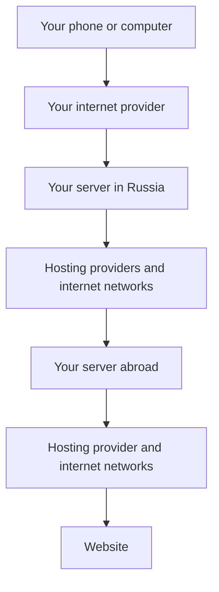
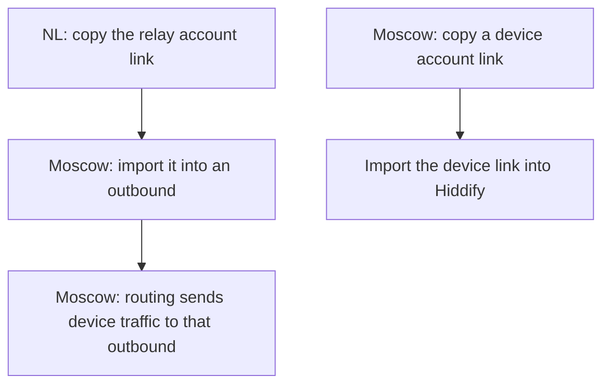
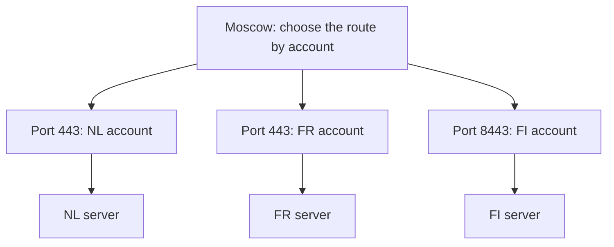
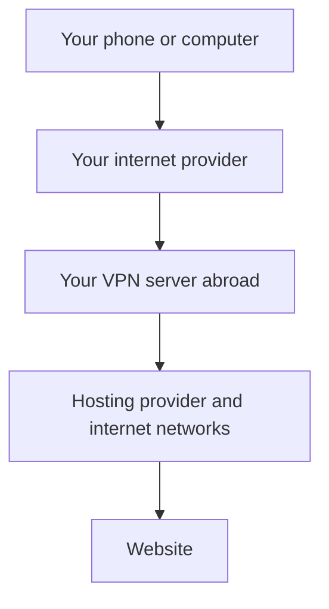

[← Start here](../../README.md) · [Set up the two servers](../two-hop-vpn.md)

# A map of the VPN

If you’re wondering which machine does what, start here. A **server** is a rented computer that stays online. The **client** is Hiddify on your phone or computer. A **connection link** tells the client which server to contact and which account to use.

With one server, your device talks to the server abroad. With two, it talks to a Russian server first. The examples below use **Moscow** in Russia, **NL** for the Netherlands, **FR** for France and **FI** for Finland. IPv4 and IPv6 are two kinds of internet address; the two-server route uses IPv6 for the middle connection.

## Follow one request



Each arrow can cross other networks too. The VPN uses internet providers just like any other connection; it doesn’t go around them. In this example, the Russian server is Moscow and the foreign server is NL. The device connection uses IPv4; Moscow’s connection to NL uses IPv6.

Moscow receives the connection from your device and opens another one to NL. VLESS is the VPN connection protocol used here; XHTTP is the way we carry traffic between the servers. Replies come back along the same path. In the tested setup, the device uses Yandex and Safari. Moscow uses a Google target name, a Chrome-shaped first message and XHTTP for its connection to NL. These settings describe connection setup, not which websites you can visit. The phone profile uses classical mode with the compatible entry core. [Handshake versions](../handshakes-and-versions.md)

## Where each link goes

An **inbound** accepts traffic into a server. An **outbound** sends it on. You’ll see these names in 3x-ui, the browser dashboard for managing the VPN. A **routing rule** connects an inbound or account to the outbound it should use.




In Moscow’s **Routing** page, send traffic from the Moscow NL inbound to the outbound named `relay-nl`. [The panel steps](../two-hop-vpn.md#how-the-two-3x-ui-panels-connect)

## Add a country



This shows account routing only. Hosting providers and internet networks carry each server-to-server connection, as in the full route above.

This is the layout once all three exits are configured. On shared port 443, Xray matches the authenticated account label to its outbound. For example, NL and FR accounts such as `desktop` and `FR-desktop` use the same port and go to different exits. The helper creates a separate inbound by default. Use `--shared-entry` with distinct country account labels to add the user-based rule on an existing RAW entry. [Xray routing reference](https://xtls.github.io/en/config/routing#ruleobject)

## Find the link that stopped working

```text
Device → Moscow          Can the device connect to the entry port?
Moscow → foreign IPv6    Can Moscow authenticate to the foreign relay?
Foreign → website        Does HTTPS return the expected IPv4 exit?
```

Test the connections in order. If the TCP port times out, check the address, route and firewall before changing fingerprints. [Reachability checks](../network-path-debugging.md)


## One server is also a complete setup



This has one panel, one account export and one server to maintain. IPv6 is optional for this path. [Single-server walkthrough](../single-server.md)

## What the second server adds

The nearby entry and foreign exit give you two independently testable connections. Your phone reaches Moscow; Moscow reaches the exit over its configured IPv6 route. Add another country by creating another foreign relay account and a matching Moscow outbound.

In our tests, the IPv6 route was usable while the IPv4 route to the same foreign host failed. That is evidence for testing both address families on your own providers. A Russian entry can still be filtered, and we have no measured reduction in blocking probability for IPv6 or for the two-server design.

The extra server adds cost, another panel and another possible failure point. First verify phone → Moscow, then Moscow → foreign IPv6, then the foreign IPv4 exit. XHTTP between servers changes the middle connection. A phone's initial REALITY handshake is still part of the first connection.

**Ready to set it up?** Choose [one server](../single-server.md) or [two servers](../two-hop-vpn.md). If you haven’t rented anything yet, [start with the rental page](../choose-server.md).
