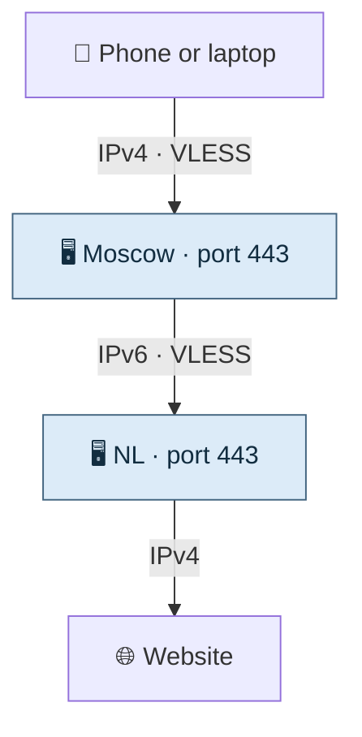
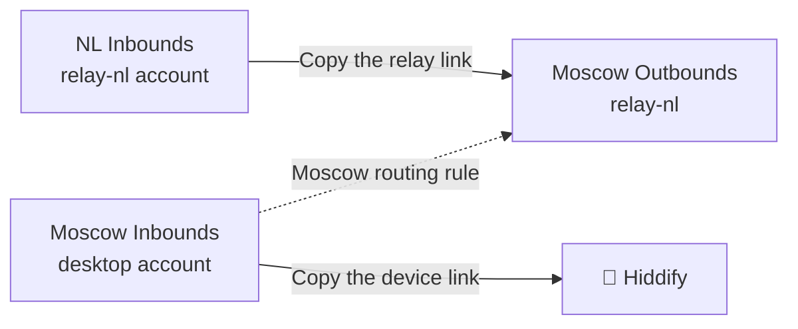
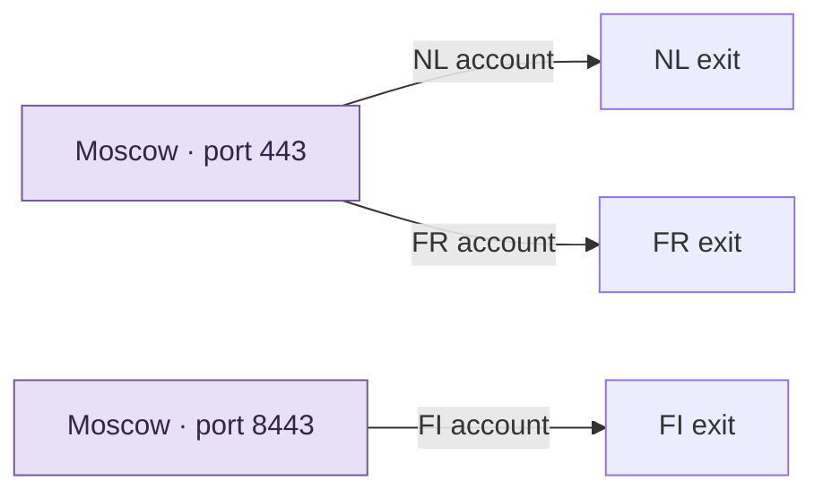

[← Start here](../../README.md) · [Set up the two servers](../two-hop-vpn.md)

# A map of the VPN

## Follow one request



```text
Device ── IPv4 + VLESS ──> Moscow :443
Moscow ── IPv6 + VLESS ──> NL :443
NL     ── IPv4 ─────────> Website
```

Moscow accepts the first VLESS connection and opens the second one. Replies come back along the same path. In the tested setup, the device uses Yandex and Safari. Moscow uses Google and Chrome for its connection to NL.

## Where each link goes



```text
NL Inbounds / relay-nl  ── copy link ──> Moscow Outbounds / relay-nl
Moscow Inbounds / desktop ── copy link ──> Hiddify
```

In Moscow’s **Routing** page, send traffic from the Moscow NL inbound to the outbound named `relay-nl`. [The panel steps](../two-hop-vpn.md#how-the-two-3x-ui-panels-connect)

## Add a country



```text
Moscow :443   / NL profile  ──> NL exit
Moscow :443   / FR account  ──> FR exit
Moscow :8443  / FI account  ──> FI exit
```

This is the layout once all three exits are configured. On shared port 443, Xray matches the authenticated account label to its outbound. For example, `NL and FR accounts, such as `desktop` and `FR-desktop` use the same port and go to different exits. The current setup helper configures a separate inbound per country. A shared inbound needs account-based routing. [Xray routing reference](https://xtls.github.io/en/config/routing#ruleobject)

## Find the link that stopped working

```text
Device → Moscow          Can the device connect to the entry port?
Moscow → foreign IPv6    Can Moscow authenticate to the foreign relay?
Foreign → website        Does HTTPS return the expected IPv4 exit?
```

Test the connections in order. If the TCP port times out, check the address, route and firewall before changing fingerprints. [Reachability checks](../network-path-debugging.md)
