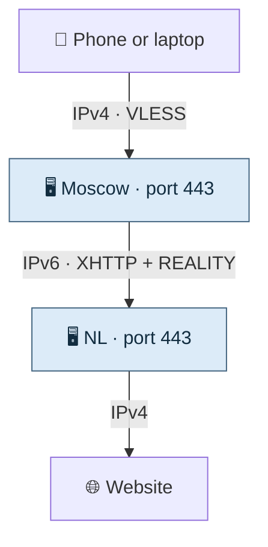
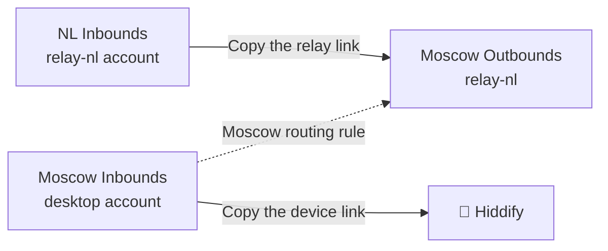
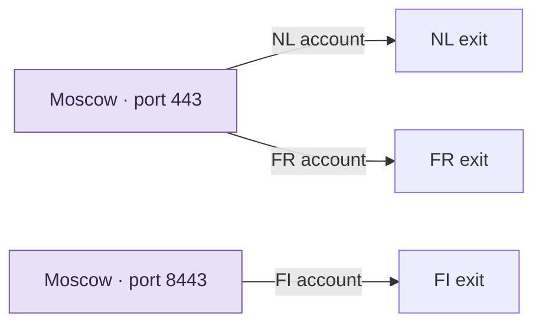

[← Start here](../../README.md) · [Set up the two servers](../two-hop-vpn.md)

# A map of the VPN

## Follow one request



```text
Device ── IPv4 + VLESS ──> Moscow :443
Moscow ── IPv6 + XHTTP ──> NL :443
NL     ── IPv4 ─────────> Website
```

Moscow accepts the first VLESS connection and opens the second one. Replies come back along the same path. In the tested setup, the device uses Yandex and Safari. Moscow uses Google, Chrome and XHTTP for its connection to NL. The phone profile uses classical mode with the compatible entry core. [Handshake versions](../handshakes-and-versions.md)

## Where each link goes



```text
NL Inbounds / relay-nl  ── copy link ──> Moscow Outbounds / relay-nl
Moscow Inbounds / desktop ── copy link ──> Hiddify
```

In Moscow’s **Routing** page, send traffic from the Moscow NL inbound to the outbound named `relay-nl`. [The panel steps](../two-hop-vpn.md#how-the-two-3x-ui-panels-connect)

## Add a country



```text
Moscow :443   / NL profile  ──> NL exit
Moscow :443   / FR account  ──> FR exit
Moscow :8443  / FI account  ──> FI exit
```

This is the layout once all three exits are configured. On shared port 443, Xray matches the authenticated account label to its outbound. For example, NL and FR accounts such as `desktop` and `FR-desktop` use the same port and go to different exits. The helper creates a separate inbound by default. Use `--shared-entry` with distinct country account labels to add the user-based rule on an existing RAW entry. [Xray routing reference](https://xtls.github.io/en/config/routing#ruleobject)

## Find the link that stopped working

```text
Device → Moscow          Can the device connect to the entry port?
Moscow → foreign IPv6    Can Moscow authenticate to the foreign relay?
Foreign → website        Does HTTPS return the expected IPv4 exit?
```

Test the connections in order. If the TCP port times out, check the address, route and firewall before changing fingerprints. [Reachability checks](../network-path-debugging.md)


## One server is also a complete setup

```text
Phone ── RAW + REALITY over IPv4 ──> Foreign VPS ── IPv4 ──> Website
```

This has one panel, one account export and one server to maintain. IPv6 is optional for this path. [Single-server walkthrough](../single-server.md)

## What the second server adds

The nearby entry and foreign exit give you two independently testable connections. Your phone reaches Moscow; Moscow reaches the exit over its configured IPv6 route. Add another country by creating another foreign relay account and a matching Moscow outbound.

In our tests, the IPv6 route was usable while the IPv4 route to the same foreign host failed. That is evidence for testing both address families on your own providers. A Russian entry can still be filtered, and we have no measured reduction in blocking probability for IPv6 or for the two-server design.

The extra server adds cost, another panel and another possible failure point. First verify phone → Moscow, then Moscow → foreign IPv6, then the foreign IPv4 exit. XHTTP between servers changes the middle connection. A phone's initial REALITY handshake is still part of the first connection.
