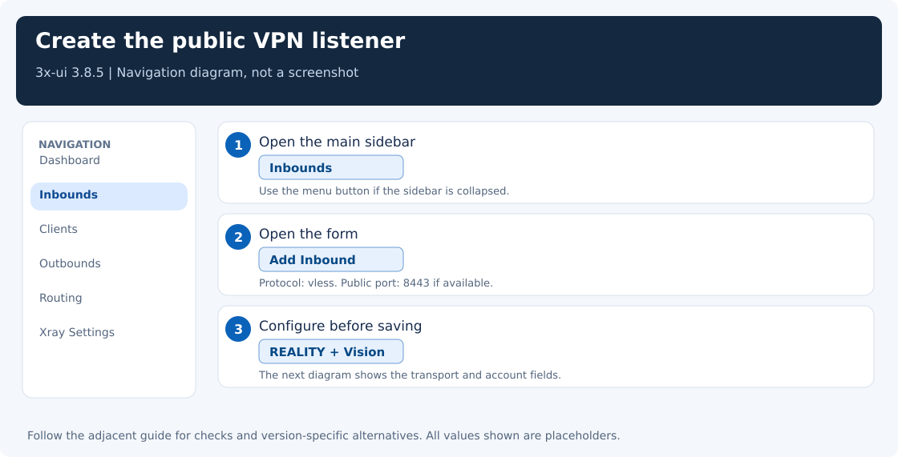
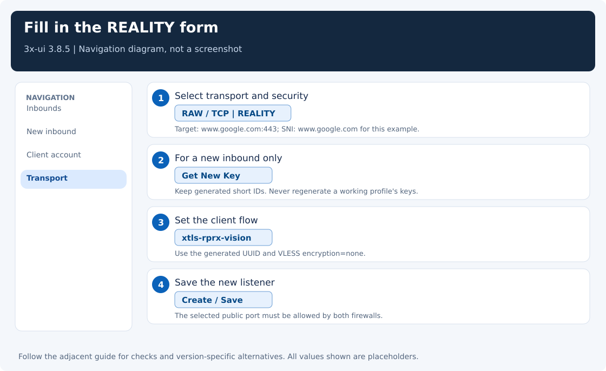
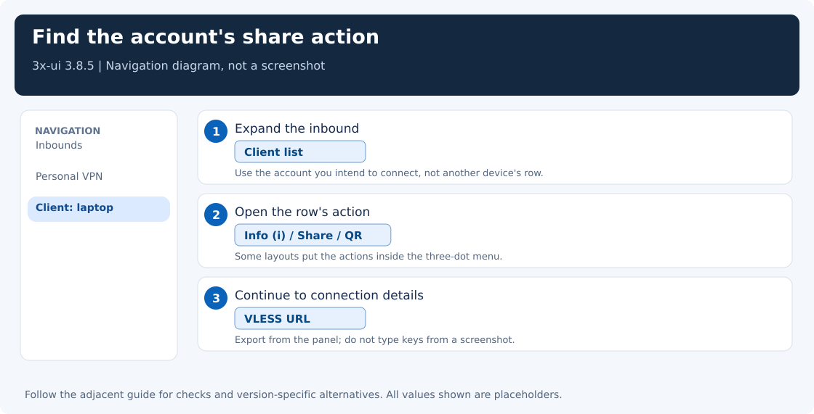
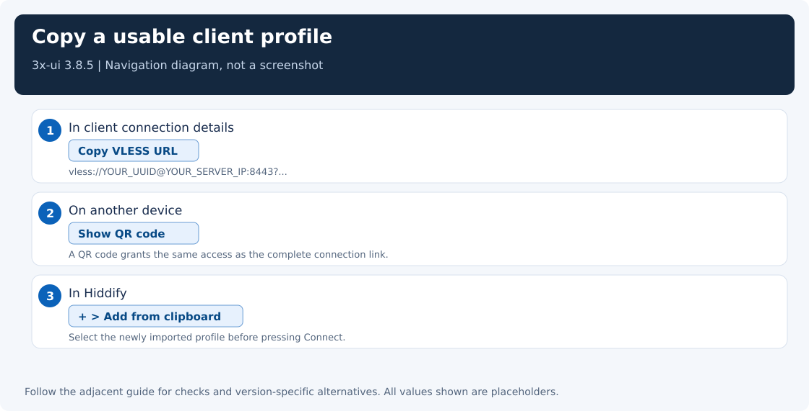

[← Setup overview](../README.md) · Step 3 of 4

# Create your first connection account

Open **3x-ui**, the browser dashboard installed on your server. Here you will create an account for one device and copy the private connection link into your VPN app.

An **inbound** is the server entry point that accepts a device's connection. **VLESS + REALITY** is the connection type used in this walkthrough; the table below supplies its required settings. An **outbound** is the path the server uses afterward to reach a website.

The dashboard runs **Xray**, the network engine that handles the connections. These labels refer to **3x-ui 3.8.5**. The panel's HTTP/HTTPS port is separate from the inbound's VPN port.

**Do this page if you need a connection account.** Already have an enabled account and its exported VLESS link? Skip this page and [open Step 4: connect your device](clients.md). Otherwise, follow sections 1–5 in order. The terminal checks and reference links are optional.

## 1. Open the correct form

1. Open the dashboard using the browser address from [Step 2](server-setup.md#required-open-the-dashboard-safely-in-your-browser). The ordinary setup uses the server's public IP and panel port; keep a forwarding window open only if you chose the optional private setup. Sign in with the panel credentials.
2. In the main left sidebar, click **Inbounds**.
3. Click **Add Inbound**. On a narrow screen, open the sidebar with the menu button first.



## 2. Set the listener

The **listener** waits for devices to connect on the selected port. Use **443 or 8443 only**, as chosen in the previous page; allow that same TCP port in the server firewall and any provider firewall.

| Field | Set it to | Check |
|---|---|---|
| Enable | On | The inbound must remain enabled |
| Remark | A recognizable name, such as `Personal VPN` | This is a display name |
| Protocol | `vless` | The imported client must also use VLESS |
| Listen IP | Empty/default, or the intended public listener address | Do not set it to `127.0.0.1` for a public listener |
| Port | `8443`, if free | Use the selected port in the client and both firewalls |

Do not replace a working listener just to match the examples. Preserve its actual port and connection parameters.

## 3. Set transport and security

| Field | Set it to | Why |
|---|---|---|
| Transmission / Network | `TCP` or `RAW` | Newer Xray names TCP transport RAW; `tcp` remains an alias in relevant releases |
| Security | **REALITY** | Different from ordinary certificate-based TLS |
| Proxy Protocol | Off | Enable only when an upstream proxy actually sends PROXY headers |
| Target / Dest | A reachable TLS endpoint, for example `www.apple.com:443` | This endpoint must work from the VPS |
| Server Names / SNI | `www.apple.com` for that example | SNI is the website name sent during connection setup; use one covered by the target’s certificate |
| Fingerprint / uTLS, when offered | Start with `safari` for this Hiddify walkthrough | Initial defaults for the exported client; test your actual network and engine |
| Short IDs | Generate a short ID | A short random label used to recognize this connection; keep the exported value |
| Private / Public Key | Click **Get New Key** for a new inbound | Keep the private key on the server |
| SpiderX, when offered | `/` | Keep the exported value |
| Sniffing | Off for the initial setup | Inspects initial traffic to identify its destination; unnecessary for this simple setup |

**Start with Safari in this Hiddify walkthrough, including non-US servers.** In the US investigation on 2026-11-07, changing only the client fingerprint gave **Safari 12/12 successful requests; Chrome 0/12**. Avoid the Chrome default for that failing setup. This is a tested choice for Hiddify 5.5.5 on the investigated network, not a rule that Chrome fails on every US server or with every client core.

**Safari also fixed the tested Hiddify timeout on a non-US endpoint.** If the server’s TCP port is reachable but Chrome fails, try Safari using the steps below, regardless of country. The optional setup helper accepts an explicit fingerprint override; a country-based default cannot replace a connection test.

**Target/SNI and fingerprint are separate choices.** This walkthrough now uses `www.apple.com:443`, SNI `www.apple.com`, and Safari as its starting preset. On the tested non-US endpoint, that combination passed 6/6 Windows Hiddify engine requests and 2/2 actual GUI VPN requests after the exported profile was refreshed. Earlier controlled Safari/Chrome comparisons kept Google SNI unchanged; choosing a different target is not evidence that Google caused those failures or that Apple prevents filtering.

For an existing account: **Inbounds → edit the REALITY inbound → Fingerprint / uTLS → Safari → Save**, then export its link or QR again and reimport it in Hiddify. Check that the new link contains **`fp=safari`**. Keep its UUID, keys, short ID, SNI, and port unchanged. This field supplies the client export; an already imported profile does not update just because you saved the panel form. See the [fingerprint troubleshooting steps](troubleshooting.md#reality-chrome-times-out-but-safari-works).

<details>
<summary>Optional: check whether the example target website is reachable. Use this if connections fail.</summary>

**TLS** is the encryption used by HTTPS websites. The REALITY target must provide suitable TLS and be reachable from your rented server (VPS). On that server, test the example target:

```bash
curl -4 -I --connect-timeout 5 --max-time 15 https://www.apple.com/
```

You should receive HTTP response headers rather than a timeout or connection error. The target must support TLS 1.3 and HTTP/2; see the [official REALITY requirements](https://github.com/XTLS/REALITY/blob/main/README.en.md). This checks website reachability; the device test in Step 4 will check the actual VPN connection.

</details>

For an existing inbound, do **not** regenerate keys or short IDs: that invalidates existing profiles. A client's REALITY public key is not the website's certificate key.



## 4. Set the client account

Some forms reveal Flow only after selecting REALITY.

| Client field | Set it to |
|---|---|
| Enable | On |
| Email / Name | A label for this device, for example `laptop` |
| ID / UUID | Generate the unique account identifier, or keep the existing account’s value |
| Flow | `xtls-rprx-vision` |
| Encryption | `none`, where shown |
| Expiry / Traffic limit / IP limit | No limit for initial testing, unless you intentionally require one |

`encryption=none` is the VLESS payload setting; the connection is still protected by REALITY. It does not mean the VPN is sent as plaintext.

Click **Create** / **Save**, then apply or restart Xray if the panel prompts for it. This can interrupt existing VPN sessions briefly.



## 5. Export the connection

The **connection profile** is a private link containing the account’s connection settings. You will import it into **Hiddify**, the VPN app on your device.

1. In **Inbounds**, expand the inbound’s client list if needed.
2. Find the intended client row.
3. Open its **Info / connection details** action, or the QR/share action. Depending on the layout, actions may be in **⋯**.
4. Copy the **VLESS URL**, or scan the client's QR code in Hiddify.

A placeholder link looks like this; import the panel's real export rather than copying this example:

```text
vless://YOUR_UUID@YOUR_SERVER_IP:8443?encryption=none&flow=xtls-rprx-vision&security=reality&sni=www.apple.com&fp=safari&pbk=YOUR_PUBLIC_KEY&sid=YOUR_SHORT_ID&type=tcp&spx=%2F#Personal-VPN
```

Check server IP, VPN port, UUID, Flow, REALITY public key, short ID, SNI, fingerprint, and transport. A correct IP with the wrong key or short ID can establish TCP and still fail REALITY authentication.

For a desktop and phone, use two separately named client accounts, `desktop` and `phone`, on this same inbound. Export each account's own link; each device keeps its own credentials and can be revoked separately. A second listener port is not required. When replacing an initial test account, verify both new accounts first, then remove the old account from the central client list as well as the inbound so exactly two accounts remain.



## 6. Optional: check the server listener from the terminal

**Skip if the saved inbound is enabled and Xray shows as running in the panel.** If it fails to start, the commands below help explain why.

<details>
<summary>Open the terminal listener and log checks</summary>

On the VPS, replacing `8443` with the actual inbound port:

```bash
ss -lntp 'sport = :8443'
journalctl -u x-ui --since '10 minutes ago' --no-pager
```

**Check:** Xray owns the intended public listener, the client is enabled, and the exported link matches it.

</details>

For an IPv4 exit address, use the separate [ForceIPv4 guide](force-ipv4.md). For failed handshakes, follow [troubleshooting](troubleshooting.md).

## Versioned references

- [3x-ui 3.8.5 inbound form source](https://github.com/MHSanaei/3x-ui/tree/v3.8.5/frontend/src/pages/inbounds)
- [Xray REALITY configuration](https://xtls.github.io/en/config/transport.html#realityobject)
- [RAW/TCP transport](https://xtls.github.io/en/config/transports/raw.html)

**Step 3 is complete when:** your inbound and account are enabled, Xray is running, and you have copied the private connection link.

**[Next step: import the account into Hiddify and connect →](clients.md)**
