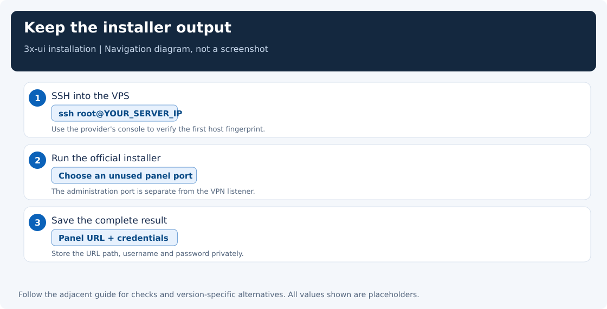
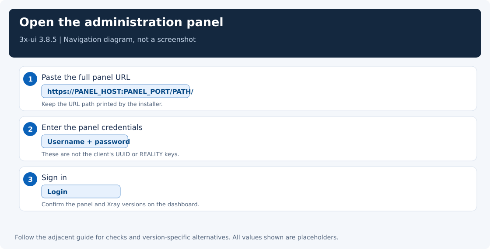

[← Single-server overview](single-server.md) · Step 2 of 4

# Install and prepare the VPN server

You have rented a Linux server and saved its login details. If you have not, start with [getting a server](choose-server.md). You can perform the steps below from Windows or Linux; the commands run on the remote server after you log in.

We will install **3x-ui**, a browser-based dashboard for managing connection accounts. Later, **Xray**, the network engine it manages, will carry the traffic. You do not need to learn either program's internals to install the panel.

UI instructions in this guide are based on **3x-ui 3.8.5**, checked on **2026-11-06**. For troubleshooting, record both the panel and Xray versions; they have independent release numbers. Existing working installations do not need a reinstall.

**Do this page if your server does not yet have a working 3x-ui dashboard.** If you can already log in to 3x-ui, skip installation and [open Step 3: create your connection account](server-inbound.md).

**Required here:** connect over SSH, install and open the dashboard, and choose the VPN port (sections 2–4). The other sections are optional background, security improvements, or extra checks. Longer alternatives are closed below so you can follow the main path without reading them.

For the [two-server path](two-hop-vpn.md), prepare the dashboard on both VPSs, select the role's core version and return to the two-server panel-linking steps. The foreign relay account is created there.

## 1. The ordinary setup: one server, one app

Use your existing rented server (**VPS**) and install **Hiddify**, the VPN app, on each device you want to connect. Windows and Linux desktops follow the same path. You do not need another server.

<details>
<summary>Optional: other deployment choices and resource notes. Skip for an ordinary personal VPN.</summary>

A **VPS** is your rented remote server. **Hiddify** is the app you will install on your devices to use it. A **proxy** forwards network requests for another program.

| You need | Deploy |
|---|---|
| A normal VPN on Windows, Linux, macOS, or a phone | One VPS, then [Hiddify](clients.md) on each device |
| An optional proxy for Linux terminal programs or a server without a desktop | One VPS, then the [standalone Xray client](linux-xray.md) |
| One proxy endpoint for several devices | The VPS plus a separate [restricted proxy host](share-proxy.md) |

Choose one row for your needs. For an ordinary Linux desktop, follow the same Hiddify path as on Windows; you do not need the standalone Xray chapter. The shared server installation below is the same for all three choices. If you already have a server, keep it and check its resources rather than ordering another one.

Use a supported Ubuntu release available from your provider, one CPU core, about 1 GiB RAM, a public IPv4 address, and enough transfer allowance. Ubuntu 22.04 and 24.04 are examples, not a requirement to reinstall a different working version. These resource values are practical starting points, not a capacity guarantee. IPv6 on the VPS is optional. HostVDS and FirstVDS are examples used by this project; check current locations, traffic limits, payment methods, and network reachability before purchasing. No particular provider guarantees an unblocked route.

</details>

## 2. Connect over SSH

**SSH** is the secure connection you use to administer the server from a command window. Open **PowerShell** on Windows or a **terminal** on Linux/macOS. The SSH command is the same on both.

Your provider supplies an IP address and a login method. If the login user is `root` (the administrator account), run:

```bash
ssh root@YOUR_SERVER_IP
```

Replace `YOUR_SERVER_IP` with the address from your provider. If the provider gave you a user such as `ubuntu`, use that name instead of `root`; after login, run `sudo -i` for the administrative installation commands below. If the provider supplied an SSH key or custom SSH port, follow its access instructions rather than assuming a root password exists.

On the first connection, SSH shows a **host fingerprint**, an identifier for the server’s SSH key. Compare it with the provider’s console when available, then accept the matching key. Enter the password at the prompt; nothing appears while you type. Keep the password out of commands and screenshots.

The following installation commands run **on the VPS**, initially as root:

```bash
apt update
apt install -y curl ca-certificates
```

These commands refresh the package list and install curl, the download tool used below, with trusted certificate data.

<details>
<summary>Optional: update the server’s other installed packages</summary>

Run `apt upgrade -y` if you want to update existing packages now. If an update requires a reboot, reboot and reconnect before continuing. This package upgrade is separate from installing the VPN panel.

</details>



## 3. Install 3x-ui

Use the [official 3x-ui repository](https://github.com/MHSanaei/3x-ui) and its [release instructions](https://github.com/MHSanaei/3x-ui/releases). Download and run the installer:

```bash
curl -fL https://raw.githubusercontent.com/MHSanaei/3x-ui/v3.8.5/install.sh -o /tmp/3x-ui-install.sh
bash /tmp/3x-ui-install.sh v3.8.5
```

The installer runs with administrator access, so use the official source linked above. **Optional review:** after downloading and before running it, `less /tmp/3x-ui-install.sh` lets you read the script; press `q` to exit. Record the installed version if you later need troubleshooting help.

### Required: install the panel and save its login details

At the installer prompts:

1. If asked for a database, keep **SQLite**, the built-in choice for a personal server.
2. Choose an unused panel port, for example **27297**, when offered. A port is a numbered network entry point. This one is for managing the server, not for VPN traffic.
3. For panel certificates, choose **Skip SSL / HTTP only** for direct HTTP browser access. The optional HTTPS instructions below explain certificates.
4. Save the printed **panel port, URL path, username, and password** in a password manager. The panel credentials are different from your root/SSH login.

### Required: open the dashboard safely in your browser

The ordinary setup opens the panel directly by the server's public IP. You do not need a second terminal or an SSH forwarding connection to keep using it.

**1. On the server**, enable the public panel listener:

```bash
/usr/local/x-ui/x-ui setting -listenIP 0.0.0.0
systemctl restart x-ui
```

**2. In your provider's firewall/security group**, allow incoming **TCP on your panel port**, for example **27297**. If the VPS already uses an active UFW firewall, add `ufw allow 27297/tcp` there too. Use your actual panel port, preserve SSH access, and do not enable or reset a firewall just for this step.

**3. In your computer or phone's browser**, open the complete saved URL:

```text
http://YOUR_SERVER_IP:YOUR_PANEL_PORT/YOUR_PANEL_PATH/
```

Replace the IP, port and path with the installer result. Keep the saved path and its slashes. A panel with the root path `/` uses `http://YOUR_SERVER_IP:27297/`. The address is on your VPS; `127.0.0.1` would mean the device running your browser.

Enter the **panel username and password**, then click **Login**. These are separate from the root/SSH password.

**Check:** the login page opens directly and the panel accepts your credentials. Closing SSH afterward does not close browser access. If the page is unreachable, check the actual panel listener and both firewalls. A listener bound to `127.0.0.1` accepts only local connections; repeat step 1 to make an existing private panel public.

<details>
<summary>Optional: use HTTPS for browser-to-panel encryption</summary>

The checked installer offers **Let's Encrypt IP certificate** without a domain. Select that option during installation and enter the public IP. For an existing installation, run `x-ui`, open **SSL Certificate Management**, and choose **Let's Encrypt SSL Certificate for IP Address** (menu 20, then 6 in 3.8.5).

Issuance and automatic renewal need incoming **TCP 80** reachable from the certificate authority. Preserve any existing service on port 80; plan coexistence rather than stopping it. Keep the panel port allowed as well. Confirm certificate installation and renewal setup succeeded, then open the printed `https://...` URL including its panel port and saved path. Check that the browser trusts the certificate.

If converting a private panel, also run `/usr/local/x-ui/x-ui setting -listenIP 0.0.0.0` and restart `x-ui`; installing a certificate alone does not change its listen address.

</details>

<details>
<summary>Optional: keep the panel private and access it through SSH</summary>

Choose this only when you want SSH to be required for browser access. For an HTTP panel, run on the VPS:

```bash
/usr/local/x-ui/x-ui setting -listenIP 127.0.0.1
systemctl restart x-ui
```

On your computer, open a second terminal and keep this command running:

```bash
ssh -N -o ExitOnForwardFailure=yes -L 127.0.0.1:18080:127.0.0.1:YOUR_PANEL_PORT YOUR_LOGIN_USER@YOUR_SERVER_IP
```

Replace the port, login user and server IP with your values. Add `-p YOUR_SSH_PORT` for a custom SSH port. Open `http://127.0.0.1:18080/YOUR_PANEL_PATH/` and sign in with the panel credentials. Closing this forwarding terminal ends browser access; the VPN keeps running. No public panel-port rule is needed for this option.

</details>

The panel port is an administration port. Do not put it in the VPN client's server-port field. See [the port map](ports-and-modes.md#the-ports-you-will-see).

If you lose the panel URL or credentials, run `x-ui` over SSH and use the menu's settings/reset options. Do not assume the installer always chooses the same defaults.



### Required: choose the core version for your profile

After the panel starts, record its **Xray version** on the dashboard. For the tested classical mobile setup, select **Xray 26.7.28** in the core version control. The fresh-server helper downloads and verifies that exact version independently of 3x-ui. If you use an existing server, back up the panel and original core before changing it, and check both desktop and phone afterward.

Use the [version table](handshakes-and-versions.md#match-the-client-option-to-the-server) to choose between classical and hybrid profiles. An ordinary software update can change this compatibility.

## 4. Choose the VPN port

This walkthrough uses **8443** for VPN traffic. A **port** is a numbered network entry point; it lets the server distinguish the VPN from SSH and the browser dashboard.

**On the server**, check that 8443 is free:

```bash
ss -lntp 'sport = :8443'
```

- **Only column headings appear:** use **8443** in the next chapter.
- **A listener appears:** preserve it and check **443**, the only allowed alternative, with `ss -lntp 'sport = :443'`. If both ports are occupied, stop and resolve the conflict without stopping an existing service or selecting another port.

Changing a port can help when one particular port is filtered. It cannot bypass filtering of the server's whole IP address.

Save the selected number. In 3x-ui you will enter it as the inbound’s **Port**. The exported connection link will then include it automatically.

**In your provider’s dashboard**, check whether this server has incoming network restrictions, usually called **Firewall**, **Security group**, or **Network rules**. If it does, allow incoming **TCP** on your selected VPN port. TCP is the connection type used by this setup. If your provider already allows incoming connections, there is no rule to add there.

You do not need to install or enable UFW for this walkthrough. Keep your existing SSH access and the separate panel-port rule from section 3.

<details>
<summary>Optional: this server already has its own firewall. Skip if you have not configured one and your server image does not include one.</summary>

A provider firewall and a firewall running on the server are separate. If the server already filters incoming traffic, allow the VPN port there too. Use its existing management tool; do not install a second firewall just for this guide.

For an existing **UFW** installation (Ubuntu’s firewall-management tool), inspect its state:

```bash
ufw status verbose
```

If it says **inactive**, do not enable it as part of this step. If it says **active**, allow your selected port, for example:

```bash
ufw allow 8443/tcp
```

Substitute your actual VPN port if you selected another value. Keep the current SSH rules. If the server uses nftables or iptables instead, update its existing policy with that tool. Do not reset the rules on a remotely managed server.

</details>

## 5. Optional: improve server administration later

**Skip for now if you want to finish the VPN setup first.** These changes help long-term administration; they are not required to establish the VPN connection.

<details>
<summary>Optional security improvements: administrator account, fail2ban, and SSH login restrictions</summary>

Create a separate administrator:

```bash
adduser YOUR_ADMIN_NAME
usermod -aG sudo YOUR_ADMIN_NAME
```

In a **second terminal**, verify `ssh YOUR_ADMIN_NAME@YOUR_SERVER_IP` works and that `sudo -v` succeeds. Keep the first session open while changing SSH access. Set up and test an SSH key before disabling password authentication.

**Optional: block repeated failed SSH logins with fail2ban.** On Ubuntu, install and start it:

```bash
apt install fail2ban -y
systemctl start fail2ban
systemctl enable fail2ban
```

Check SSH protection with `fail2ban-client status sshd`. If it lists the `sshd` jail, protection is active. If it reports an error, inspect `systemctl status fail2ban --no-pager` and `journalctl -u fail2ban --no-pager`; do not assume installation alone enabled protection on every Ubuntu image.

If you choose to disable root SSH login, set `PermitRootLogin no` in the effective SSH server configuration, check `sshd -t`, then reload `ssh`. Ubuntu include files can override settings; verify the effective result with `sshd -T`. Test a new administrator login before closing the original session.

</details>

## 6. Optional: check the service from the terminal

**Skip if the dashboard opens normally.** If it does not, run on the server:

```bash
systemctl is-active x-ui
```

The expected result is `active`. For any other result, use [the server checks](troubleshooting.md#server-checks). You do not need to collect version numbers or read logs before moving to the next page.

**Step 2 is complete when:** the panel opens, you know the selected public VPN port, and SSH still works.

**[Next step: create your connection account →](server-inbound.md)**
