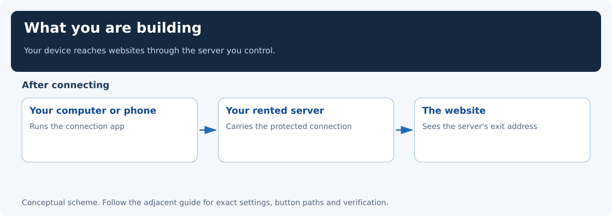
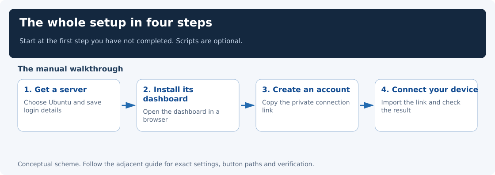
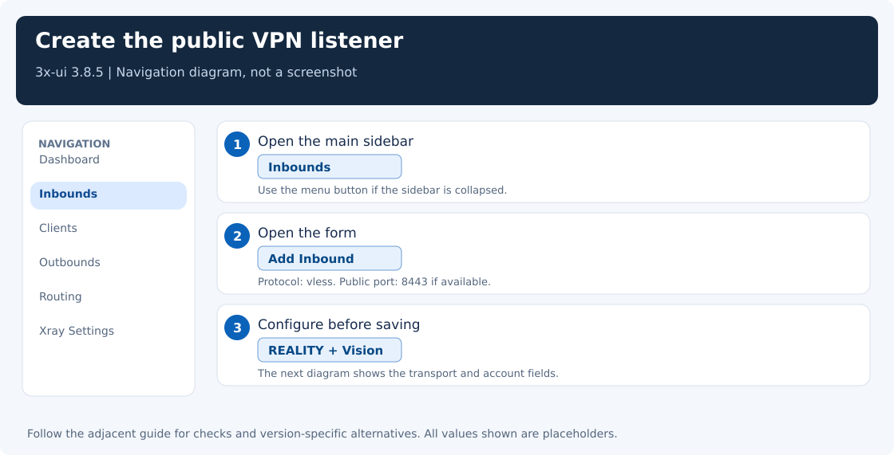
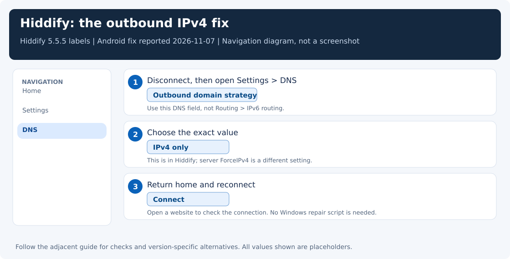
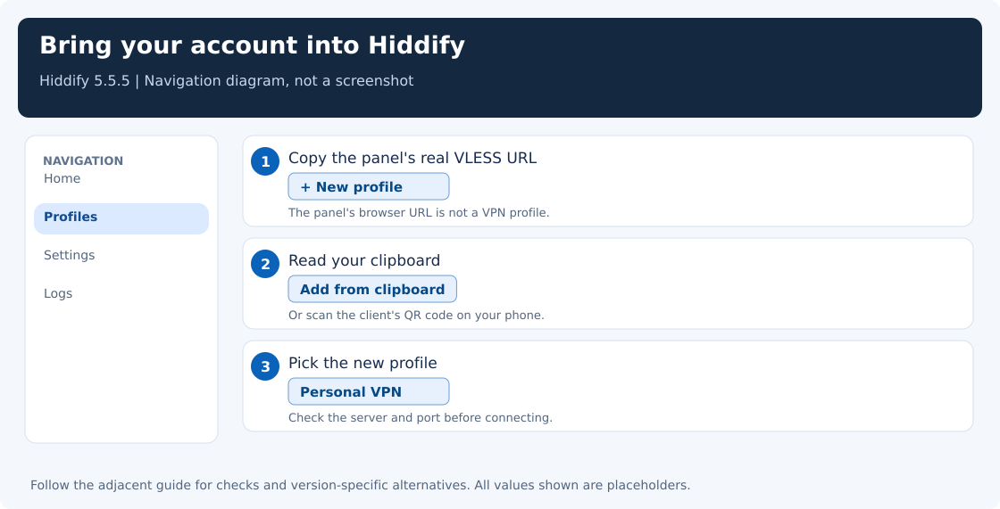

[← Choose a setup](../README.md) · [Two-server path](two-hop-vpn.md)

# Single-server VPN

This guide takes you from having nothing set up to connecting your computer or phone through your own server in another country.

Here, your own **VPN** is an encrypted connection to a server you control. Your device connects to that server, and the server connects to websites for you. You control the server and the accounts that can use it. Network filtering can still affect the connection; the guide includes checks to help you find and fix problems.



## What you need

- **A computer for the initial setup.** Windows or Linux both work; you do not need to install Linux on your Windows computer. You can connect a phone afterward too.
- **A rented Linux server**, often called a **VPS**. This is a small computer running in a provider's data center. You pay the provider to keep it running. **If you do not have one, start with Step 1 below.**
- **The server's login details.** The provider supplies an IP address and either a password or an SSH key. The main administrator account is usually called **root**. You get these details after creating the server.

We use Ubuntu as the server's operating system. You do not need one specific Ubuntu version: choose a supported release available from your provider. The version used for the examples is not a requirement for your own computer or server.



## Set this up with scripts

<details>
<summary>Open the commands for the same single-server setup</summary>

Use a fresh Ubuntu/Debian VPS with systemd and its public IPv4 address. An existing 3x-ui installation needs the manual path. Save the root login from your provider.

**Windows PowerShell**, from the repository folder:

```powershell
.\scripts\Setup-Vpn.ps1 -ServerIp 203.0.113.10 -VpnPort 8443 -Target www.apple.com -CoreVersion 26.7.28 -KeyShare classical -Fingerprint safari -Clients desktop,phone
```

This prints the plan. Check the address, then repeat the command with **`-Apply`**.

**Linux/macOS terminal**, from the repository folder:

```bash
python3 scripts/bootstrap_server.py --host 203.0.113.10 \
  --vpn-port 8443 --target www.apple.com --core-version 26.7.28 \
  --key-share classical --fingerprint safari --clients desktop,phone --plan
```

Check the plan, then replace **`--plan`** with **`--apply`**. Replace the documentation address with your own VPS address in either example.

SSH asks for the root password privately. The helper installs the panel, verifies the selected core download, creates the two device accounts and prints the panel address and private output directory. Open **client-desktop.txt** or **client-phone.txt** there, copy its whole link, and import it into Hiddify with **+ → Clipboard**.

Press **Connect**, open an IP-check page and confirm the server's exit address. Try a real website on Wi-Fi and mobile data. If a provider firewall blocks the printed VPN or panel port, allow that specific port in the provider dashboard.

For an XHTTP experiment, add `-Transport xhttp` or `--transport xhttp` before applying. That profile uses an empty flow and path `/vpn`. [All options and recovery](automation.md#start-with-only-a-vps-ip-and-root-password)

</details>

## Follow these steps in order

This page is the map. Open the guide linked under your step, finish that page, and use its **Next step** link at the bottom. The four summaries below are not extra instructions to repeat.

Already have a server? Start at Step 2. Already have the server dashboard installed and can open it? Start at Step 3. Already have a private connection link from the server’s administrator? Start at Step 4.

### 1. Get a server

For example, use **[HostVDS](https://hostvds.com/)** and choose a European or US location, a small plan, and Ubuntu. This is the provider used in the original guide; another suitable provider works too.

The walkthrough includes a HostVDS example: **Servers → New Instance → region and plan → Operating Systems → Ubuntu → Deploy**, followed by the login details to save.

**[Start here: choose and create your server →](choose-server.md)**

Already have a suitable server? Continue with Step 2.

### 2. Install the server's control panel

The control panel is a website on your server where you can create connection accounts and change settings. We use a free panel called **3x-ui**.

You will connect to the server through **SSH**, a secure way to administer it from a terminal, run the installation commands, and open `http://YOUR_SERVER_IP:YOUR_PANEL_PORT/YOUR_PANEL_PATH/` directly in your browser. The ordinary setup does not require an SSH forwarding window. The walkthrough shows the commands for both Windows and Linux and explains the installer prompts.

**[Install 3x-ui and open it in your browser →](server-setup.md)**

### 3. Create your connection account

In 3x-ui, click **Inbounds → Add Inbound** and fill in the settings shown in the guide. An *inbound* is the server entry point that accepts your device's connection.

The starting preset is **Xray 26.7.28, RAW on port 443 or 8443, target/SNI www.apple.com, Safari fingerprint, Vision flow and a classical Hiddify key share**. Check the core version before creating the profile. [Version and handshake explanation](handshakes-and-versions.md) Use separate **desktop** and **phone** accounts on the same inbound when connecting both devices. The guide explains how to verify the profile and refresh an existing import.

The guide uses a connection type called **VLESS + REALITY**. You can follow its field-by-field instructions without learning the protocol first.

When you finish, the panel gives you a **connection profile**: a link containing the server address and the account's connection settings. You will import that link into the app on your device.

**[Create the account and copy its connection link →](server-inbound.md)**



### 4. Connect your computer or phone

You now need an app on your device to use the profile. We use **Hiddify**, a free app for connecting to your server, available for Windows, Linux, macOS, Android, and iOS.

Install it, import your connection link using **+ → Add from clipboard**, and select the profile.

**Important for Hiddify: Settings → DNS → Outbound domain strategy → IPv4 only.** This helped in an initial Android test, but the timeout later returned. Treat it as a DNS check when diagnosing a failure. Set it in Hiddify, reconnect, and test a website. This is different from the server’s IPv4 exit setting. The guide explains which connection mode to choose, what each setting does, and how to check that websites see your server's address.



**[Install Hiddify and make your first connection →](clients.md)**



Already received a working connection profile from someone else? You can start at this step; you do not need to rent or configure another server.

## If something does not work

**Wi-Fi works but mobile data fails? Start with [the core version and key-share mode](handshakes-and-versions.md).** For DNS failures, check [Outbound domain strategy → IPv4 only](clients.md#3-important-set-outbound-domain-strategy-to-ipv4-only). If that does not help, use [the troubleshooting guide](troubleshooting.md). It helps you distinguish a blocked server port, an incompatible client, a wrong profile, and a Windows proxy setting that still points at another app.

Two common follow-up questions have their own illustrated pages:

- [Make websites see the server's IPv4 address](force-ipv4.md).
- [Understand the ports and what the Connect button changes](ports-and-modes.md).

## Optional XHTTP entry

The single-server helper accepts `--transport xhttp` or PowerShell `-Transport xhttp`. It creates an XHTTP + REALITY inbound with path `/vpn` and an empty client flow. Export its own matching profile. The tested single-server and mobile-entry baseline is RAW; try XHTTP as a separate controlled experiment. [Transport and handshake differences](handshakes-and-versions.md#raw-or-xhttp)

## Optional shortcuts and deeper reading

**Scripts are optional.** Everything above can be done manually. If you prefer a helper to prepare a new server from its IP and root login, use the [optional automatic setup walkthrough](quick-start.md). The [automation guide](automation.md) explains each helper before you run it.

For other setups:

- [Use a Moscow hub and a foreign IPv6 relay](two-hop-vpn.md).
- [Use the Xray network engine directly on a Linux machine](linux-xray.md).
- [Let another device use your proxy](share-proxy.md).
- [Debug a VPN that works through another connection but fails directly](network-path-debugging.md).
- [How Xray, REALITY, and routing work—for programmers and network engineers](xray-internals.md).

The UI examples were checked with 3x-ui 3.8.5 and Hiddify 5.5.5. Pictures are labeled navigation diagrams, not captured screenshots. Button positions may change between versions; the linked walkthroughs include alternatives.
