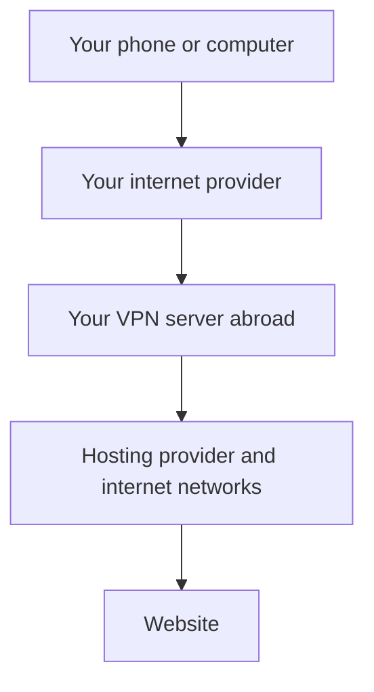

[← What a VPN does and where to start](../README.md) · [Two-server route](two-hop-vpn.md)

# Your first VPN: one server

We’ll rent a computer abroad, set up the VPN on it, and connect your phone or computer. You’ll end up with a connection you can switch on in Hiddify whenever you need it.

That rented computer is the **server**. Hiddify is the **client** app on your device. The server stays on in the hosting company’s data centre; your own computer can be switched off once setup is done.



Each arrow can cross other networks too. The VPN uses internet providers just like any other connection; it doesn’t go around them. The encrypted VPN connection runs from your device to the VPN server, through your provider.

## What you need

- A Windows, Linux or Mac computer for the setup. It doesn’t have to run the same operating system as the server.
- A server rental. If you don’t have one, the first page below shows you how to get one and what to pay attention to.
- Your phone too, if that’s where you want to use the VPN.

We’ll choose Ubuntu, a Linux operating system, for the rented server. You don’t need to install Ubuntu on your own computer. The guide uses **3x-ui**, a browser dashboard, to manage the VPN, and **Hiddify** to connect your devices.

## Follow these steps in order

Each link opens the instructions for that step. Finish the page, check the result at the bottom, and follow its next link. You don’t need to read the whole guide before starting.

### 1. Get a server

Choose a hosting company and country, rent a small server, and save the address and login details it gives you.

**[Rent a server →](choose-server.md)**

Already have a server and its login? Start with step 2.

### 2. Install the server’s control panel

You’ll open a terminal on your computer, connect to the server, and paste the installation commands. Then you’ll open the new dashboard in your browser.

**[Install and open the dashboard →](server-setup.md)**

Already able to sign in to 3x-ui? Start with step 3.

### 3. Make a link for each device

In the dashboard, create a phone account and a computer account. Each gets a private connection link. The instructions show which fields to fill in and which to leave alone.

**[Create your connection links →](server-inbound.md)**

### 4. Connect your computer or phone

Install Hiddify, add your device’s link, and press Connect. Open a website and check that the connection uses your server. On a phone, try both Wi-Fi and mobile data.

**[Set up Hiddify and connect →](clients.md)**

That’s the whole route. Once your websites open and the address check matches your server, you can stop.

## Set this up with scripts

<details>
<summary>Open the commands for the same single-server setup</summary>

Use a fresh Ubuntu/Debian VPS with systemd and its public IPv4 address. An existing 3x-ui installation needs the manual path. Save the root login from your provider.

**Windows PowerShell**, from the repository folder:

```powershell
.\scripts\Setup-Vpn.ps1 -ServerIp 203.0.113.10 -VpnPort 8443 -Target www.apple.com -CoreVersion 26.7.28 -KeyShare classical -Fingerprint safari -Clients desktop,phone
```

This prints the plan. Check the address, then repeat the command with **`-Apply`**.

**Linux/macOS terminal**, from the repository folder:

```bash
python3 scripts/bootstrap_server.py --host 203.0.113.10 \
  --vpn-port 8443 --target www.apple.com --core-version 26.7.28 \
  --key-share classical --fingerprint safari --clients desktop,phone --plan
```

Check the plan, then replace **`--plan`** with **`--apply`**. Replace the documentation address with your own VPS address in either example.

SSH asks for the root password privately. The helper installs the panel, verifies the selected core download, creates the two device accounts and prints the panel address and private output directory. Open **client-desktop.txt** or **client-phone.txt** there, copy its whole link, and import it into Hiddify with **+ → Clipboard**.

Press **Connect**, open an IP-check page and confirm the server's exit address. Try a real website on Wi-Fi and mobile data. If a provider firewall blocks the printed VPN or panel port, allow that specific port in the provider dashboard.

For an XHTTP experiment, add `-Transport xhttp` or `--transport xhttp` before applying. That profile uses an empty flow and path `/vpn`. [All options and recovery](automation.md#start-with-only-a-vps-ip-and-root-password)

</details>

## If something does not work

Start with [the symptom table](troubleshooting.md#first-choose-the-symptom-that-matches-yours). It helps you check the failed part without changing everything at once.

If Wi-Fi works but mobile data doesn’t, read [the mobile connection checks](troubleshooting.md#wi-fi-works-but-mobile-data-hangs). The app and server versions matter here; the setup pages tell you which tested versions to use.

## Optional XHTTP entry

XHTTP is another way to carry the VPN traffic. The working phone setup in this guide uses RAW, so keep that for your first connection. If you want to test XHTTP later, use a separate account and follow [the XHTTP settings](server-inbound.md#optional-xhttp-instead-of-raw). Changing transport also means importing a matching new link.

## Optional shortcuts and deeper reading

- [Use scripts for a fresh server](quick-start.md).
- [Understand one server versus two](schemes/README.md).
- [Choose the address websites see](force-ipv4.md).
- [Understand Hiddify’s connection modes](ports-and-modes.md).
- [Use the VPN from Linux terminal programs](linux-xray.md).
- [Read how the protocols work](xray-internals.md).

**Next:** if you’re starting from nothing, [rent your server](choose-server.md).
