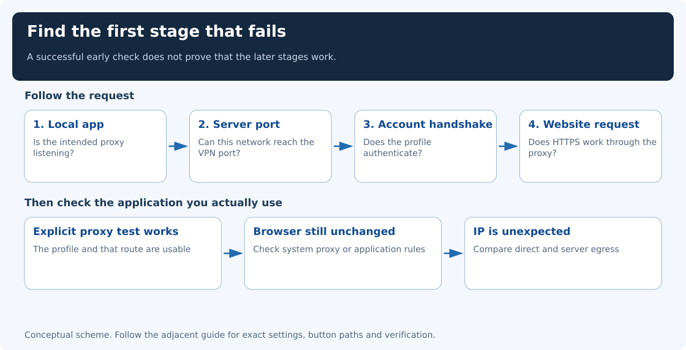
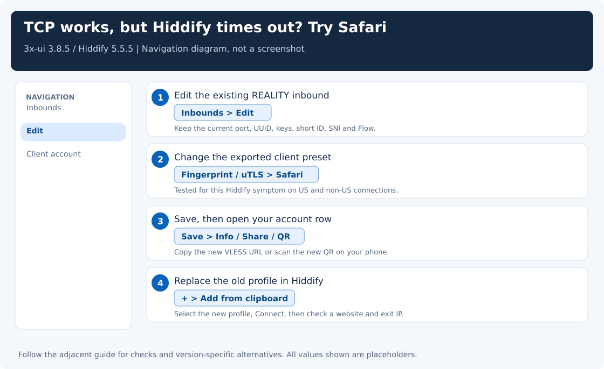

[← Guide index](../README.md) · [Hiddify setup](clients.md) · [Diagnostic helpers](automation.md)

# The server pings, but the VPN does not work

**Use this page when a check fails.** Choose your symptom from the table below, then read that section. These are diagnostic branches, not additional steps every working setup needs.

A server can answer ping or let you log in while its VPN connection fails. Those are different connections, so start with the symptom below.

**Hiddify** is the app on your device. **3x-ui** is the server’s browser dashboard, and **Xray** is the network engine it manages. A network engine is also called a **core**. Your rented server is the **VPS**, and its **exit address** is the address websites see when you use it.



## Wi-Fi works but mobile data hangs

Start with the [version and handshake table](handshakes-and-versions.md). Hiddify 5.5.5's newer hybrid ClientHello can be much larger than the older client's opening message. On a compatible older server, `keyshare=classical` requests the smaller one. Xray 26.9.9 rejects that option.

In this deployment, Moscow on 26.7.28 with a classical phone profile produced a successful NL mobile test. Wi-Fi success, a green app button and a ping are separate observations. Record the mobile operator, phone OS, client/core versions and the exact new log error when a mobile request fails.

Test one change at a time. If a website briefly loads and then stalls, capture the connection on the entry server while retrying on mobile data. Check whether the initial ClientHello is complete and whether later packets are acknowledged. A different fingerprint, Russian SNI or IPv6 route by itself provides no general guarantee.

## Hiddify: first check Outbound domain strategy

**Initially reported as an Android improvement on 2026-11-07; the timeout later returned.** In **Hiddify → Settings → DNS → Outbound domain strategy**, select **IPv4 only**, reconnect, and test a website. If the server’s TCP port opens but websites still time out, check the fingerprint below too.

[See the short button-by-button walkthrough](clients.md#3-important-set-outbound-domain-strategy-to-ipv4-only). The earlier changes to Fake DNS, Region, and IPv6 routing had not fixed the phone. Windows preference-file edits are not the first step for this symptom.

This is an app setting. The similarly named server outbound setting in 3x-ui controls the server’s website connections; it is not the same control.

## REALITY: Chrome times out, but Safari works

**Use this branch when the server’s TCP port opens but Hiddify cannot load websites.** The tested US and non-US connections both worked with **Safari** when **Chrome** failed. A fingerprint is the browser-style initial TLS connection message; it is separate from the target website's name, called SNI.

1. Open **3x-ui → Inbounds** and edit the existing REALITY inbound.
2. Set **Fingerprint / uTLS → Safari**, then **Save**. Keep the target/SNI, port, UUID, keys, short ID, and Flow unchanged.
3. Open the account's **Info / Share / QR** action and export again. Check that the link contains **`fp=safari`**.
4. Import the new link or scan the new QR in Hiddify, select that profile, and reconnect. Saving the panel form alone does not update the old profile on your phone.
5. Open a real website and the [exit-address check](clients.md#4-connect-and-check-a-website). A latency badge alone is not a complete connection test.



**Optional cleanup if import left two copies:** first select and test the new profile. Then open **Hiddify → Profiles → old profile’s ⋮ → Delete → OK**. This removes the old saved profile from this device; it does not delete the account on your server. If Hiddify added a number to the new name, use **⋮ → Edit → Name → Save** to restore the name shown by 3x-ui after removing the old copy.

**What was isolated on 2026-11-07:** alternating requests through the installed Windows Hiddify 5.5.5 engine, to the same original VLESS/REALITY/Vision account and US server, produced **Chrome 0/12 successes and Safari 12/12**. Only the fingerprint changed. Both fingerprints authenticated through an SSH control path. The Safari REALITY phone check was still pending when those results were recorded; the separately tested Trojan/TLS phone connection is a different setup.

Captures at both ends showed incomplete Chrome-style handshakes reaching the VPS, despite retransmissions of the missing bytes by the client. This supports fingerprint-dependent loss or interference between the device and VPS; it does not identify the responsible operator or prove a blanket restriction on every US server. Smaller TCP segments and fragmentation did not produce a reliable fix in that investigation.

The Google target/SNI stayed unchanged when Safari worked. **Do not confuse Google's website name with the Chrome browser fingerprint**, or replace working target names on the strength of this result. Different client cores can produce different handshakes for the same fingerprint label; retest after changing engines or versions.

A later non-US deployment reproduced an intermittent Chrome failure with the same desktop account: in an alternating Windows Hiddify engine comparison, the full Chrome configuration passed 0/2 HTTPS requests and Safari passed 2/2 while the Google target stayed fixed. After the owner requested a non-Google target, Safari with `www.apple.com` passed 6/6 requests after the server settled, followed by 2/2 requests through the actual Hiddify GUI VPN connection. Both account exports were refreshed from 3x-ui, and the existing desktop profile was replaced without changing its UUID. Initial requests immediately after target/service changes timed out; do not count only later successes or call a restart an instant fix.

Direct reachability on that later deployment subsequently failed: native Windows and Linux SSH timed out, direct TCP checks on SSH/VPN/panel ports failed, but the same account authenticated through an existing proxy and the panel returned HTTP 200 there. See [investigation D](network-path-debugging.md#recorded-investigation-d-success-followed-by-direct-reachability-loss). The earlier 6/6 and GUI 2/2 results do not describe the latest direct state.

These results establish compatibility on that tested path. They do not rank hostnames by visibility or promise protection against a future destination-IP block. If SSH and VPN traffic both fail from one network while the server remains reachable elsewhere, investigate the network path before changing account credentials.

**This can happen outside the US too.** A second, non-US endpoint tested on 2026-11-07 produced **Chrome 0/4 and Safari 4/4** in alternating Windows Hiddify 5.5.5 requests with the same account and connection settings. After reimporting the panel’s Safari export, the app’s actual VPN Connect button passed two website requests with the expected exit address. Use the fingerprint steps above for this symptom regardless of server country.

That second investigation had two separate stages: initially, even TCP connections could not reach the server; later, TCP worked but Hiddify’s Chrome handshake still failed. Changing fingerprints helps diagnose the second stage. Always repeat the TCP check when conditions change, and test a website after ping succeeds.

## First, choose the symptom that matches yours

| What you see | Start here |
|---|---|
| The app says connected, but the browser did not change | [Check the Windows proxy](#the-app-is-green-but-windows-still-uses-the-old-proxy) |
| Connection refused on localhost | [Find the local listener](#connection-refused-on-localhost) |
| Hiddify times out | [Set its outbound domain strategy to IPv4 only](#hiddify-first-check-outbound-domain-strategy) |
| REALITY TCP port opens, but `fp=chrome` times out | [Try the tested Safari fingerprint](#reality-chrome-times-out-but-safari-works) |
| Hiddify still times out after that change | [Test the VPN TCP port](#ping-works-so-test-the-vpn-port-next) |
| `reality verification failed` or `processed invalid connection` | [Check the handshake and core version](#the-tcp-port-opens-but-reality-fails) |
| TCP opens but every fingerprint times out, or the profile works through another VPN | [Compare direct and alternate paths](network-path-debugging.md) |
| The IP check shows IPv6 | [Check the server's egress](force-ipv4.md) |
| HTTPS works, but the app's latency test fails | [Check the test endpoint](#the-latency-test-and-a-real-request-disagree) |
| Hiddify's plain profile works, its full app configuration fails | [Reduce the optional settings](#the-profile-works-but-the-apps-generated-configuration-fails) |

## The app is green, but Windows still uses the old proxy

A manual-mode Hiddify connection does not select its proxy for Windows. Read the current choice in PowerShell:

```powershell
Get-ItemProperty 'HKCU:\Software\Microsoft\Windows\CurrentVersion\Internet Settings' |
    Select-Object ProxyEnable,ProxyServer
```

If it shows `127.0.0.1:10801` while Hiddify listens on `12334`, Windows still selects the other client. You do not need to stop that client. First test Hiddify explicitly:

```powershell
curl.exe --noproxy localhost,127.0.0.1 --proxy http://127.0.0.1:12334 --connect-timeout 5 --max-time 15 https://www.cloudflare.com/cdn-cgi/trace
```

If that returns the VPS exit IP, use **Hiddify → Settings → Inbound → Service mode → System Proxy** when you intentionally want Windows applications to follow Hiddify. Or keep both clients in their present modes and configure an individual application. See the [illustrated Windows proxy steps](ports-and-modes.md#windows-selects-a-proxy-it-does-not-merge-them).

## Connection refused on localhost

A request to `127.0.0.1:12334` that is refused has not reached the VPS. Hiddify is disconnected, the mixed port is disabled, the port changed, or another process prevented it from starting.

Check **Settings → Inbound → Local proxy** and the [listener command](ports-and-modes.md#check-the-actual-state-in-powershell). Match the curl port to the actual listener. Do not open the VPS firewall to fix a missing localhost listener.

If you see “address already in use,” give the clients different ports. Changing both to 10801 creates a conflict, not compatibility.

## Ping works, so test the VPN port next

Ping sends a small network probe using ICMP. The VPN uses a different connection type, TCP, on its configured port. Test that actual port next.

From Windows PowerShell, substitute the actual VPN port:

```powershell
Test-NetConnection YOUR_SERVER_IP -Port 443
```

If `TcpTestSucceeded` is false, compare the port in the exported profile, the server listener, the host firewall, and the provider security group. Use a mobile hotspot as a comparison when possible. Run the check from the device and network where the VPN fails; a mobile hotspot comparison can help reveal a network-specific block.

If the port is reachable, try [a webpage request through Hiddify](clients.md#press-connect-then-prove-the-route). REALITY can forward an unauthenticated connection to its configured target website, so merely receiving a website response directly from the server port does not check your VPN account.

## The TCP port opens, but REALITY fails

REALITY is the protected connection type selected in the server account. These messages mean connection setup failed; read the surrounding log entries too, because the last message alone may not identify the cause:

```text
REALITY: processed invalid connection
reality verification failed
failed to find an available destination
```

1. Compare IP, VPN port, UUID, Flow, transport, REALITY public key, short ID, SNI, and fingerprint with the panel's export.
2. Check account enablement, expiry, quota, and IP restrictions.
3. Check the server clock with `timedatectl status` and the device’s date/time settings. Correct either clock if it is wrong.
4. Record the app version and its **network engine/core version**. The app’s About or Logs page may show both; an app and its engine can have different version numbers.
5. Test the same profile with a known compatible current core, using [the temporary client helper](automation.md#test-a-real-authenticated-tunnel).

The tests recorded for this guide found that Xray client **25.1.30** failed against Xray server **26.9.9**, while client **26.10.31** connected with the same account link and provider. [Invisible Man - XRay Client](clients.md#switching-from-invisible-man---xray-client), a Windows VPN/proxy app used in the original guide, bundled that older engine in release 3.2.5. If your engine is similarly outdated, update the client and retest; copying the account link again leaves the engine unchanged.

Some newer REALITY servers require changes to the initial encrypted connection setup, which older engines may lack. Hiddify 5.5.5 connected successfully in the recorded tests. The [technical explanation](xray-internals.md#why-a-valid-profile-can-stop-working-after-an-update) covers the version-specific details.

## The whole server is unreachable from one network

If both SSH and the VPN fail from a Russian connection while the server still responds from another country, that is evidence of a network-dependent reachability problem. It is consistent with filtering or routing failure on the affected path; it does not by itself identify the responsible operator or prove a nationwide block. A failed ping alone is weaker evidence because ICMP may be disabled.

Changing SNI, browser fingerprint, UUID or port does not bypass a destination-IP block. A non-443 port can help only when the restriction is specific to a port or traffic pattern. Safari and the Apple target passed the recorded Hiddify tests; no tested preset guarantees continued reachability or prevents later IP blocking.

Check the server in the provider console and compare the same SSH/VPN endpoints from independent networks before resetting accounts. For an assistant, follow the repository's direct-SSH gate and stop live work after a failed direct login rather than switching to a proxy. Keep any separately authorized alternate-path evidence clearly labeled.

## The same profile works through another VPN

Label the direct and existing-proxy exits separately, repeat the same account over both paths, and compare packet headers at the client and VPS. The [network-path investigation guide](network-path-debugging.md) gives the commands, controlled tests and recorded anonymous case evidence. It covers historical port experiments, target/SNI/fingerprint comparisons, missing handshake bytes and the limits of identifying the dropping operator.

## The profile works, but the app's generated configuration fails

A profile contains the account’s connection settings. Hiddify adds its own settings, including DNS (website name lookups) and rules that choose which traffic uses the VPN. Those additions can explain why a valid account link works in one test but fails in the app.

**Check the visible [Outbound domain strategy setting](#hiddify-first-check-outbound-domain-strategy) and, for the investigated US REALITY symptom, [the fingerprint](#reality-chrome-times-out-but-safari-works).** The initial DNS improvement later stopped working; the hidden preference edits below were not isolated as the cause either.

In the earlier Windows investigation, the installed Hiddify Windows core repeatedly connected with a small configuration, while the complete generated configuration failed. Rebuilding the app configuration with **Region Other**, **Fake DNS off**, **independent DNS cache off**, and **Clash API off** was followed by a successful request through the app’s proxy. Because several options changed together, re-enable them one at a time if you want to find which option affects your device.

Use the [Hiddify recovery walkthrough](clients.md#advanced-recovery-when-the-normal-settings-are-not-enough). Start with the visible UI options. For hidden preferences, the repair helper previews changes and saves a backup. Re-enable features individually, testing after each one; note which change reintroduces the symptom.

Do not patch `data/current-config.json` and expect the fix to persist. It is rebuilt on the next connection.

## The latency test and a real request disagree

The app's “ping” may measure a web endpoint through the proxy, not ICMP. That endpoint can be blocked, return a different status, be unavailable, or fail while the tunnel itself works.

In Hiddify, open **Settings → General → Connection test URL**, choose a reachable endpoint, reconnect, and compare with a fresh explicit HTTPS proxy request. A single IP-information API returning HTTP 429 is a rate limit from that API; it is not by itself proof of a failed REALITY handshake.

If websites fail but the port is reachable, read the error from that request rather than treating a successful TCP probe as success for the whole VPN.

## Server checks

Run these **on the VPS**, not on your Windows PC:

```bash
systemctl is-active x-ui
systemctl --failed --no-pager
ss -lntp 'sport = :443'
timedatectl status
journalctl -u x-ui --since '10 minutes ago' --no-pager
```

Use the actual inbound port. No separate `xray.service` may exist when Xray runs under 3x-ui. You can also run the [read-only server check helper](automation.md#check-the-vps-without-changing-it).

Check direct internet access from the VPS separately:

```bash
curl -4 -I --connect-timeout 5 --max-time 15 https://www.google.com/
curl -6 -I --connect-timeout 5 --max-time 15 https://www.google.com/
```

A failed IPv6 test is not a problem if you deliberately use IPv4 only. Inspect host firewall rules with the tool already used by your installation, such as `nft list ruleset` or `ufw status verbose`. Do not flush firewall rules, reset keys, reinstall the server, or restart unrelated applications as a first diagnostic step.

## Read fresh logs, not the last installation's error

On the checked Windows installation, Hiddify's files were under:

```text
%APPDATA%\Hiddify\hiddify\app.log
%APPDATA%\Hiddify\hiddify\box.log
%APPDATA%\Hiddify\hiddify\data\box.log
```

Locations vary by package. Use Hiddify's **Logs** page first. Record the time, reproduce one failed request, and look for new entries from that run. Old errors can remain after an upgrade. `context canceled` during a deliberate disconnect is often cleanup, so find the earlier error that caused the failure.

Temporarily use an informative log level if the app offers it, then restore the normal level after diagnosis. Before sharing logs, remove profile links, UUIDs, credentials, tokens, and sensitive browsing destinations.

## Send a report another person can reproduce

A useful report contains the versions, client OS, selected mode, VPN port, local proxy port, exact error, and results of a direct request and an explicitly proxied request. It also says whether the same profile works with another core or provider.

This gives the person helping you a specific failed check to investigate, along with the versions and settings needed to repeat it.
