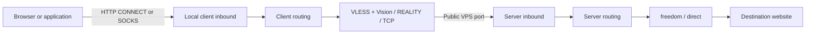
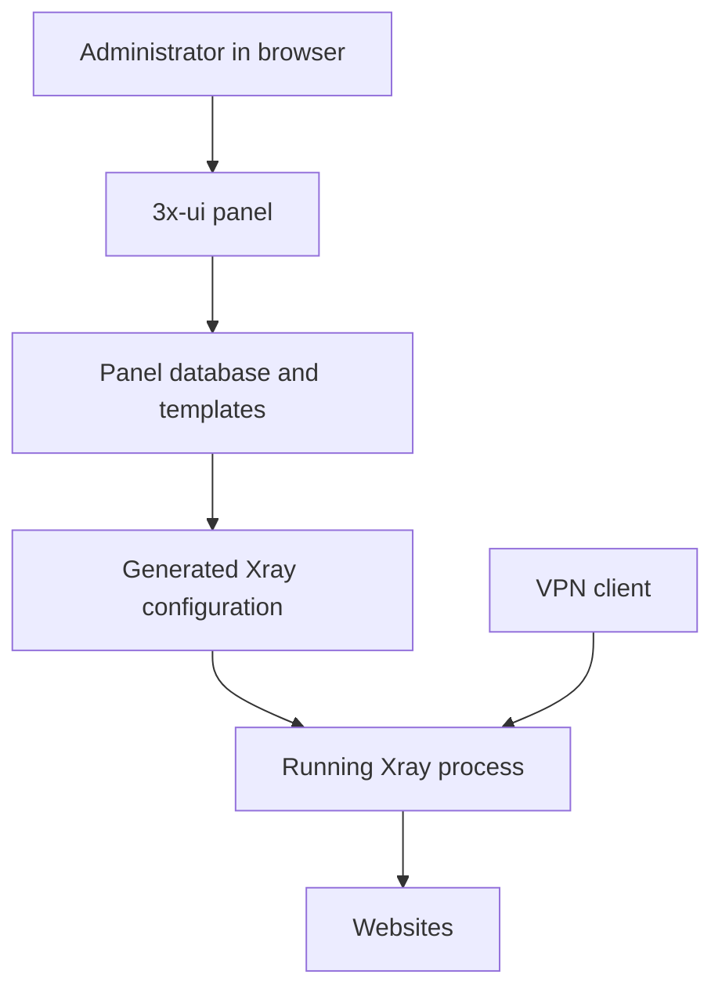
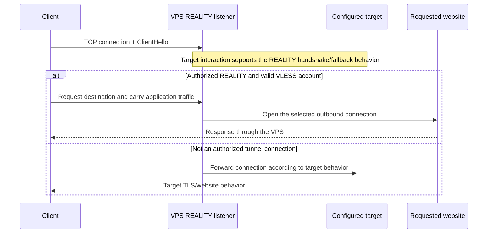

[← Guide index](../README.md) · [Practical client setup](clients.md) · [Troubleshooting](troubleshooting.md)

# Inside Xray: follow one request through the tunnel

A browser asks for a page. Somewhere between a localhost listener and a VPS abroad, several protocols agree on identity, transport, encryption, and destination. The GUI compresses all of that into a Connect button.

This chapter opens that box. You can follow the ordinary setup without reading it, but understanding the layers makes failures much easier to localize—and explains why a perfectly valid connection link can stop working after a core update.

## The two-minute picture

Xray is a programmable proxy engine. A configuration gives it **inbounds** that accept traffic, a dispatcher/router that chooses a path, and **outbounds** that carry traffic onward. The same executable can be a local client or a remote server because those are configuration roles.

For this guide, the Windows/Linux client accepts local proxy requests and sends VLESS over RAW/TCP with REALITY to the VPS. The VPS accepts that inbound, authenticates the account, and usually chooses a freedom/direct outbound to the destination.



The application still talks to the destination website. The tunnel changes the path that carries those bytes and which machine opens the final connection.

## Keep the control plane separate from the data plane

3x-ui is a management application: it stores accounts, templates, policies, and statistics, then generates configuration and controls an Xray process. It is not the engine forwarding each browser byte.



This separation explains three familiar surprises. The panel can load while the VPN core is broken. Xray may be a child of `x-ui` without a separate systemd service. A hand edit to the generated `bin/config.json` can disappear the next time the panel rebuilds it. Persistent changes belong in the panel's configuration source.

Client GUIs have a similar split. Their profile import is only the first stage; they add DNS, routing, selectors, monitoring, and OS integration before the engine runs. A minimal profile test and the application's full configuration test exercise different systems.

## VLESS, REALITY, RAW and Vision each have a job

| Layer | Job in this setup | Example setting |
|---|---|---|
| VLESS | Identify the account and describe the destination request | UUID and destination host/port |
| RAW/TCP | Carry the connection over an ordinary TCP stream | `type=tcp` in many share links |
| REALITY | Authenticate and protect the client/server transport with a TLS-derived handshake | Public/private key, SNI, short ID |
| Vision | Handle the initial traffic shape and eligible encrypted payload copying | `flow=xtls-rprx-vision` |
| Routing | Decide which outbound gets a request | `outboundTag: direct` |

A transport name is not an encryption algorithm, and a client's display name is not an authentication identity. The [transport documentation](https://xtls.github.io/en/config/transport.html) describes the combinable layers. An imported link serializes parameters; it does not negotiate away incompatible choices.

### The VLESS request has a small envelope

At the protocol level, the conventional VLESS request header describes a version, account UUID, optional addons, command, destination port, address type, and address, followed by request data. Addons carry features such as flow-related metadata. The response has its own short header before response data.

That means the proxy can request `example.com:443`, not merely an already-resolved IP. Where resolution happens becomes a configuration decision. It also explains why accepting a TCP socket is not evidence that the server accepted a VLESS account.

In this guide's profile, `encryption=none` refers to the VLESS-layer encryption option. REALITY supplies transport protection. Newer Xray also has separate VLESS Encryption features; they are not enabled by this example. Do not generalize this configuration into “VLESS is always plaintext” or confuse a UUID with the REALITY key pair. See the [wire format](https://xtls.github.io/en/development/protocols/vless.html) and [VLESS outbound settings](https://xtls.github.io/en/config/outbounds/vless.html).

## What makes REALITY more than a TLS checkbox

Ordinary HTTPS proves a server's identity through certificates and their trust chain. REALITY adds a different authorization path for the tunnel while arranging plausible behavior for connections that are not authorized clients. The configured **target** is part of that behavior; it is not automatically the website the user is visiting.

The server holds a REALITY private key. A client receives the corresponding public key, a short ID, a server name, and other parameters. The client handshake uses an ephemeral key exchange and derived authentication material; protocol metadata includes version/time information and the short ID. The server validates the expected values using its own key material and policy. These details are implementation-specific; use the [official REALITY implementation](https://github.com/XTLS/REALITY) rather than designing a lookalike handshake from this explanation.

The server name affects the TLS-looking handshake and target behavior. The short ID participates in recognition; it is not a replacement for the VLESS UUID. A complete share link carries both transport parameters and account access.



The diagram deliberately omits record-level exchange details. A successful generic TLS probe can follow the lower branch. It does not prove the upper branch works.

### The target is not a magic cloak

A usable target needs compatible TLS behavior and must be reachable from the VPS. The chosen SNI should fit the intended target/certificate behavior. A server in one data center and its target in another also have measurable timing and path properties.

REALITY is intended to reduce recognizable proxy behavior; it cannot promise that the IP, traffic timing, implementation bugs, or a particular network's policies will never expose or block the connection. Operational reachability is an observed property of a deployment, not a permanent property of a protocol name.

## Vision: the interesting part of TLS inside a tunnel

An HTTPS request already carries an inner TLS connection between the application and website. A conventional TLS proxy can wrap that encrypted stream in another encrypted stream, adding processing and a particular record/length structure.

Vision examines the beginning of the carried stream, adds protocol padding while handling the initial exchange, and can switch eligible TLS 1.3 traffic to a more direct copying path. It does not decrypt the website's application content, and it does not discard protection for arbitrary plaintext payloads. Compatibility, recognized traffic, and the transport path determine which optimization is available. The [VLESS inbound documentation](https://xtls.github.io/en/config/inbounds/vless.html#userobject) describes the supported flow combinations.

For a programmer, the useful distinction is between the **protocol state machine** and the **copy optimization**. In [Xray 26.10.31's implementation](https://github.com/XTLS/Xray-core/blob/v26.10.31/proxy/proxy.go), `VisionReader` and `VisionWriter` track traffic state; TLS filtering and padding/unpadding decide when the protocol can move on. Direct-copy eligibility is tracked separately, and the copy helper can use a more efficient path where both connections and the platform allow it.

On Linux, eligible sockets may benefit from `splice`-style copying. Seeing `CopyRawConn splice` in a debug log is useful evidence about that transfer path; its absence is not itself a tunnel failure. “Zero copy” is not an unconditional end-to-end guarantee, and the Windows path is not the Linux kernel path.

## Three different DNS decisions can affect one page

The application may resolve a name before it asks a proxy for a connection. A SOCKS client can either send an IP or ask the proxy to resolve a hostname; an HTTP CONNECT request can carry a hostname too. The local client may also resolve names for routing. Finally, the VPS may resolve the requested hostname when opening its direct outbound.

```text
Application resolver     → may produce an IP before proxying
Client routing resolver → may influence which outbound is selected
Server outbound resolver→ chooses the destination address at egress
```

A remote DNS setting on the client does not automatically control all three. Fake DNS adds a mapping from synthetic addresses back to domain names; it only works properly when the relevant DNS and traffic paths pass through the machinery maintaining that mapping. It is not a universal repair for a TLS authentication error. See [Xray DNS](https://xtls.github.io/en/config/dns.html) and [FakeDNS](https://xtls.github.io/en/config/fakedns.html).

This explains how a connection to an IPv4 server address can produce an IPv6 exit. The client reached the VPS over IPv4, but a hostname request still allowed the VPS to choose IPv6. [ForceIPv4 on the server's actual freedom outbound](force-ipv4.md) controls that hostname-resolution decision. A literal IPv6 destination and a routing rule blocking IPv6 are separate cases.

## Routing is ordered policy, not a list of wishes

Routing associates a request with an outbound. A broad earlier match can make a later rule unreachable. A country bypass can send some traffic directly even while the selected VPN profile is healthy. Multiple address-family and DNS rules can change which address is available by the time a match is attempted.

The useful debugging unit is therefore not just “this hostname.” Record the inbound, address representation, matching rule, chosen outbound, resolver, and effective configuration. Preserve the panel's API rules when changing server routing. The [routing documentation](https://xtls.github.io/en/config/routing.html) describes rule evaluation.

The freedom outbound has its own final checks too. An allowed routing decision does not necessarily override its destination policy; keep existing `finalRules` when changing a family preference. See [freedom](https://xtls.github.io/en/config/outbounds/freedom.html).

## Why a valid profile can stop working after an update

Configuration compatibility and wire compatibility are different contracts. A parser can accept `security=reality` and `fp=chrome` while the engine emits a ClientHello that the server's newer policy rejects.

A concrete example: the [REALITY change adopted in the 26.9.8/26.9.9 period](https://github.com/XTLS/REALITY/commit/8cdf7bf9c7f09cb9814bf08c3eb877f68b85fba8) rejects older/atypical ClientHello key-share layouts that omit the expected X25519MLKEM768 share before an optional standalone X25519 share. Client implementation and fingerprint handling therefore matter. A string named `chrome` is not a frozen byte sequence across engines or releases.

**sing-box** is another proxy engine; **Hiddify**, the VPN app in the practical guide, uses a modified version of it. The [sing-box compatibility report](https://github.com/SagerNet/sing-box/issues/4520) tracks affected implementations and experimental fixes. For the recorded setup, Hiddify 5.5.5’s own engine connected successfully. Compare actual engine versions and results when applying that report to another installation.

The reproduced comparison used the same profile, provider, destination, and server: Xray **25.1.30** failed; **26.10.31** succeeded against server **26.9.9**. That is evidence for a core-dependent failure, not evidence that the UUID needed regeneration. A separate comparison then showed Hiddify's plain profile working while its full generated configuration failed; the [recorded settings repair](clients.md#advanced-recovery-when-the-normal-settings-are-not-enough) addressed that second problem.

Similarly, finding an Xray module in a GUI binary proves a build dependency, not that its traffic is carried by an Xray backend. Inspect the actual execution path or test it. The checked Hiddify fork's [Xray outbound constructor](https://github.com/hiddify/hiddify-sing-box/blob/1614c5edb52dd44a4cc079201ba1e790fdfad8a0/protocol/hiddify/xray/outbound.go) returned an unimplemented error.

## TCP, UDP and the meaning of a local proxy

The example Linux HTTP inbound carries HTTP proxy traffic, including HTTPS CONNECT streams. A JSON flag saying `udp: true` does not turn that HTTP proxy into a general UDP tunnel. Browser QUIC, games, and DNS have their own behavior and may require SOCKS UDP support, XUDP-capable paths, or TUN integration.

Multiplexing, UDP encapsulation, and RAW/TCP transport are different choices. Sending many logical flows over one TCP connection changes loss and head-of-line behavior; it is not automatically a performance improvement. Keep the documented simple flow working before adding mux, transport wrappers, or fragmentation.

At the OS boundary, System Proxy selects a proxy for applications that honor it, while TUN captures traffic through routing/interface integration. That distinction survives regardless of how sophisticated the remote protocol is. The [ports and modes walkthrough](ports-and-modes.md) shows the concrete Windows settings.

## Turn a mystery into an experiment

For each test, write an explicit hypothesis and the observation that would falsify it:

| Hypothesis | A useful experiment | What it does not prove |
|---|---|---|
| The server IP is unreachable | ICMP/SSH/TCP comparison | Protocol authentication |
| The public VPN port is blocked | TCP connect from the affected network | REALITY and VLESS correctness |
| The profile is invalid | Compare export, then authenticate using a compatible core | The original GUI's integration works |
| The GUI's added config is the problem | Same native core with minimal versus generated config | Which optional setting alone caused it |
| Windows selected the wrong client | Read proxy endpoint, then explicitly test both local listeners | Every application follows system proxy |
| IPv6 is leaking locally | Compare direct and proxied exit addresses and paths | An IPv6 exit is inherently a leak |

Use local loopback, external-network, and real application tests for the layers each can observe. Keep a working baseline, change one variable when practical, and keep secrets out of logs and Git. The [automation helpers](automation.md) make the repeatable parts less tedious without deciding network policy for you.
